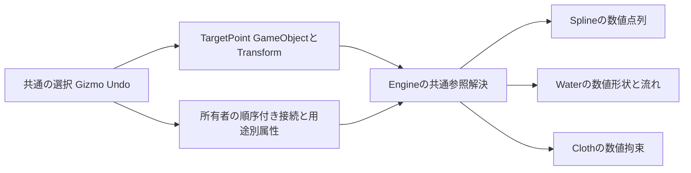

<!-- @file    control-point-authoring.md -->
<!-- @brief   TargetPointを共通の配置点とし用途別の接続と数値snapshotへ解決する設計。 -->
<!-- @author  Hasegawa Jin -->
<!-- @date    2026-10-08 -->
# 共通TargetPointと制御点の設計

2026-10-08に段階1〜5を実装。TargetPointは通常のGameObjectに小さなMarker Componentを付け、位置の正本をTransformに置く。Spline、Water、Cloth等の利用側が順序と用途固有の設定を持ち、Engineが既存の数値データへ解決する。選択・Gizmo・Hierarchy・Undoを共用し、計算量の多い実行経路へGameObject参照を持ち込まない。

共通化の対象は著者が配置する点、接続参照、編集操作である。Waterの波、Clothの物理質点、生成したMesh頂点は各ドメインの数値データとして維持する。永続的なPointObjectsと静的ベイクを実装し、ビルド時のMarker除去は段階6へ残す。追加用途の調査は[control-point-usage-audit.md](control-point-usage-audit.md)に記録する。

## 構成と責務

| 部品 | 正本として持つもの | 実行時の扱い |
|---|---|---|
| TargetPointComponent | Markerの表示色・画面上のサイズ・表示設定 | 自前のTick、Script、MeshRendererを付けない |
| GameObject | Transform、instanceId、親子関係、名前 | Live参照の位置や必要な姿勢を提供する |
| 用途別Binding | target参照、安定したbinding ID、順序、用途別属性 | 所有者単位で一括解決する |
| 数値snapshot | 解決済みの座標・属性・元データ署名 | 読み取り専用で描画・物理へ渡す |

Markerにはowner、点のindex、Water幅、Cloth質点番号を持たせない。一つの点を複数の所有者から参照でき、用途や順序を変更してもMarkerを同期し直す必要がない。逆参照は編集と変更検出のためにEngine/Editorで導出し、Sceneには保存しない。

Markerの非表示は編集表示だけを変える。GameObjectの非アクティブ化、欠損参照、非有限Transformは利用側の入力を無効にし、点列から自動的に省略しない。Runtimeの位置参照はMarkerの表示設定から独立する。Water/SplineがPointObjectsを使う場合はMarkerを要求し、既存ClothAttachmentはBoneや通常のGameObjectも引き続き受け付ける。

## 識別子と参照

Targetの永続的な識別子はGameObject.instanceIdであり、名前やHierarchyの順番では引かない。実行中は同一Sceneで解決した世代付きEntityIDを使う。binding IDは所有者内の行の識別子で、target GUIDとは分ける。targetの差し替えでも行の属性を保ち、複製時にtarget GUIDを書き換えてもbinding IDを変えない。

Waterのbinding IDには既存WaterSplinePoint.idをそのまま使う。通常SplineのPointObjectsには非ゼロのowner内IDを明示的な変換時に割り当てる。いずれも32bit整数で、既存Water反射との互換のため1〜INT32_MAXとし、追加は未使用の最小IDを選ぶ。並べ替えは参照・ID・属性を含む行全体を移動する。曲線の順番はBindingリストだけが定める。

欠損してもtarget GUIDを保存できる共通参照契約を使う。現在のScriptObjectReferenceのGUIDと実行EntityIDの二重表現、およびObjectReferenceFieldの保存/再解決経路を再利用する。単なるEntityIDからの再保存で欠損GUIDを空にする経路へ新しいBindingを流さない。Scene再読み込み、Prefab展開、clone-setの再対応は、この共通参照境界を通す。共通型は小さなScene参照ヘッダーへ分離し、MarkerやBindingの公開ヘッダーへScript.hppの重い依存を増やさない。

PrefabReferenceReflectorへ型付きObjectReferenceの再対応を追加し、GUIDと実行IDを同時に更新する。GUIDを正本としてScene世代ごとに解決し直し、別Sceneの偶然同じEntityIDへ接続しない。削除や未解決状態でもGUIDは消さない。

Editorのdrag/Undo対象はScene世代、Entity世代、instanceId、Component寿命、binding IDを持つ。Componentのアドレスを寿命の識別に使わず、Scene::GetComponentLifetimeで再追加を区別する。

## 用途別の接続

| 利用側 | 接続行の提案 | 位置と単位 |
|---|---|---|
| Spline | binding ID、target参照 | target位置をSpline所有者のlocal XYZへ解決 |
| Water | 既存point ID、target参照、width、depth、flowSpeed | widthはowner local full width、depthはworld m、flowSpeedはworld m/s |
| Cloth | binding ID、質点番号、topology署名、target参照、local offset、maxDistance | offsetはtarget local、maxDistanceはworld m |
| 後続のAI VFX Camera | target参照と利用側の設定 | 位置や姿勢は利用側が採用範囲を宣言 |

owner配下の点はownerを原点としてEngineと同じ親子TRS規則を相対評価し、owner-local位置を求める。大きな絶対worldPositionを作ってから差し引く経路へ往復させない。owner外の点は明示的なworld参照として、target.worldPositionとowner.worldPositionの差、owner.worldRotationの逆、符号付きworldScaleを使う。この外部参照ではworld floatの精度限界が残る。ownerの逆変換は一括解決の最初に用意する。零近傍scale、不正Quaternion、非有限値は適用前に拒否する。Markerのrotation/scaleはWaterの幅・深さ・速度の倍率にしない。既存Cloth offsetはtargetのTRSを使い、拘束半径をscaleしない。

WaterのPointObjectsでも既存Splineの点数・交差・退化・予算の検証と、水平なowner TRS契約を維持する。安定IDと属性を含むWaterSplinePointを生成用に解決し、既存WaterSplineSnapshot/WaterZoneSnapshotへ接続する。Zoneに属する水域も、それぞれの元の制御点を編集する。

湖は平面制約を維持する。PointObjectsへの変換時に共通local YをlakePlaneHeightとして保持し、すべての解決点がその高さに既存許容値1e-4以内で一致することを要求する。範囲外を平均・投影して黙って直さない。湖のowner編集モードでは点GizmoをXZへ制限し、Surface Height操作はlakePlaneHeightと管理下の点を一つのUndoで変更する。共有/外部の点を含む場合は一括高さ変更を拒否し、対象の切り離しまたは明示的な参照差し替えを求める。通常のTransform操作やScriptで非平面にした場合は湖の診断を出す。川と通常Splineの点はXYZを使用する。

Clothの物理質点やウェイトは配列とブラシを維持する。TargetPointを使うのは、明示的な固定先/追従先の少数の接続だけとする。既存ClothAttachmentのparticle、target、localPosition、maxDistanceの意味を維持し、Markerの原点を固定先にする操作ではoffsetを0にする。新しい接続にはClothAssetのtopology署名を持たせ、再importで質点番号の意味が変わった場合はstaleとして再割り当てを求める。位置やmaterialだけの変更でtopology署名を変えない。旧接続へ読み込み時に現在の署名を付けて「検証済み」と偽装せず、旧接続の既存動作と未検証状態を表示する。

## 正本の切り替えと移行

Spline/Waterのauthoring位置ソースをINLINEとPOINT_OBJECTSで明示する。既存Sceneの項目欠損はINLINEとして読み、GameObjectを生成しない。INLINEは既存points/splinePointsが正本であり、POINT_OBJECTSはBindingのtarget Transformが位置の正本になる。位置の相互同期は行わない。

「制御点をTargetPointへ展開」はEditorの一括Mutationで実行する。

1. 対象型、点数、ID、有限値、entity容量、Scene/Component寿命、Prefab編集状態を検証する。
2. ownerの子にIdentity TRSのControlPointsコンテナとN個の点を準備する。管理下の点のlocal scaleは1、rotationはIdentityを初期値とし、元のlocal位置を直接設定する。絶対world座標への往復を挟まない。
3. Bindingへ既存Water ID/width/depth/flowを移し、通常SplineのIDを割り当てる。
4. 点数・順序・数値生成結果が変換前と一致することを確認する。
5. 全作成と参照が成功してからsource modeを切り替え、一件のUndoへ記録する。

容量不足や失敗ではsource modeと元のデータを変えず、準備した新しい点/コンテナだけを回収する。Reflect、Scene load、毎フレームの更新では生成しない。旧位置の配列はUndoのコマンドに保持し、POINT_OBJECTSを保存するときは第二の編集可能な位置正本として保存しない。

「点オブジェクトを数値点へ戻す」は現在の参照をすべて解決してINLINE値へ変換する明示操作である。ソース切り替えで所有者以外から参照される点を削除しない。管理下で参照がなくなった点を削除するかは、別の明示的な削除操作として扱う。

## Hierarchyと編集操作

標準の生成構成はowner / ControlPoints / Point_01等の通常GameObjectとする。名前は表示だけに使う。管理下の子を通常Hierarchyに表示し、ownerの「Edit Points」で点を目立たせる。外部/共有ターゲットは明示的な参照モードで接続し、管理下の子として数えない。

### Editorでの操作手順

1. 編集モードで利用側のGameObjectを選ぶ。Scene View左上の「制御点」カードから点列編集へ入れる。InspectorにもTransformの下に制御点と目標の操作欄がある。
2. 数値点列はScene ViewまたはInspectorの「TargetPointへ変換」で点を作成して接続する。Scene Viewで変換した場合は点編集も開始し、作成点をHierarchyへ表示する。単一の目標は「TargetPointを作成して接続」、Clothは「TargetPointを作成して固定」を使う。
3. 点列は「点を編集」または「点編集を開始」を押す。各行の「点を選択」、目標欄の「参照先を選択」、HierarchyまたはScene Viewの点クリックで配置点を選べる。
4. Scene View上の丸い点をクリックして選択する。Shiftで追加、Ctrlで選択を切り替えられ、HierarchyとInspectorも選択に同期する。選択点とhover点は名前と輪郭を強調する。移動Gizmoをドラッグして離すと確定し、移動候補はEscで取り消せる。姿勢を使う目標点は回転・拡縮ツールも使える。点列の静的ベイクを使う場合は形状変更後に「ベイクを更新」を実行する。
5. 点を選んだInspectorで「接続先を確認」を押すと、参照を持つGameObjectを一覧し、「利用側を選択」で接続欄へ戻れる。親子関係だけの点は接続として数えない。確認は明示操作であり、一覧を毎フレーム全Sceneから再生成しない。

| 用途 | 最初に行う操作 | 作成した点の配置 |
|---|---|---|
| Water | Surface ShapeのShapeをSpline LakeまたはSpline Riverにして変換 | Water / ControlPoints / Point |
| Spline | 既存の数値点を変換 | Spline / ControlPoints / Point |
| Local Line | 既存の数値点を変換 | Line / ControlPoints / Point |
| World Line・Patrol | 既存の数値点を変換 | Scene rootの独立した点グループ |
| Off-Mesh Link | 両端を変換、または起点・終点を作成 | Scene rootの独立した点グループ |
| Cloth | 質点、固定点位置、offset、最大移動距離を指定して作成・固定 | Clothの子。既存のBoneやGameObjectも接続可能 |
| Camera・Transform制約・NavAgent | 対応する目標を作成・接続 | ownerの移動に巻き込まれない兄弟またはroot |
| IK目標・Pole・VFX端点 | 対応する目標や端点を作成・接続 | 動く部位に追従させる点は子、固定目標は独立配置 |
| MotionWarp・LOD中心 | 対応するTargetPointを作成・接続 | 用途ごとの姿勢捕捉・追従設定に従う |
| Light・FlowField | 配置方式を選び、配置基準を作成・接続 | 独立した兄弟またはroot。TransformConstraintで接続 |

RectangleのWaterは範囲で形を指定し、輪郭用の点列を生成しない。既存の数値点はScene読み込み時に自動展開されない。手で作ったTargetPointを子にしても利用側への参照は増えず、対応する接続欄で明示的に指定する。確認一覧の保存済みScript参照は既存の保守的なGUID照合を用いるため、Script内の同じGUID文字列を参照候補として含むことがある。

Light/FlowFieldの方式選択は適用候補であり、接続中の点への適用、既存点の選択、点の作成で確定する。接続を解除しても共有可能な点自体は削除しない。

Editor側の共通ControlPoint編集サービスが、Markerの可視化・画面位置のクリック判定・利用側のBinding表示・制約・操作を集める。通常のGameObject選択/Gizmoを使い、複数の点の移動は一つのgestureへまとめる。owner Transformや生成Meshの頂点を点操作から直接変更しない。TargetPointの移動はworld位置のdeltaからlocal位置を逆算し、移動操作でrotation/符号scaleを分解し直さない。

ownerのEdit Pointsだけでなく、Hierarchyから直接TargetPointを選んだ移動gestureも同じcandidateサービスへ送る。TargetPointを含む移動gestureでは通常GO Gizmoの毎フレームのScene書き込みを抑止し、二つの操作経路を同時に実行しない。他のGOだけを選んだ場合は既存の操作を維持する。湖のXZ制約はowner編集モードに適用し、直接選択の自由なTransform操作はXYZを使って利用側の診断を表示する。

TargetPointの回転・拡縮は通常のTransform Gizmo経路を使い、位置専用candidateと同時にmouseを取得しない。回転・拡縮では通常Gizmoを点のクリック判定より先に駆動し、点と重なる中央ハンドルも操作できる。単独点の回転はlocal位置と符号付きscaleを維持し、拡縮はlocal位置とrotationとscaleの符号を維持する。通常Gizmoの途中でScene、選択、モード、座標系、pivot、対象IDや元TRSが変わった場合は、変更していない対象だけ開始姿勢へ戻して中断する。正常完了時は既存の一件のTransform Undoへまとめる。

Waterの幅・水深ハンドルは、利用側の編集情報を共通サービスへ供給する。幅はlocal曲線法線をsigned world TRSへ変換した方向で編集し、水深はworld鉛直方向で編集する。位置を動かしただけで幅・水深・速度を変えない。Clothの密な点は同じ描画/ヒット判定部品を使えるが、識別はownerとparticleでありEntityIDには見せかけない。

点のヒット判定をGOピッキング・矩形選択より先に行う。各viewportのimage矩形と投影を使い、near/far、背面、非有限座標、矩形外を除外する。Game/UI Viewは点編集のmouseを取得しない。Terrain/Cloth brush、Alt orbit、既存スナップ、overlay、orientation gizmoとの同時取得を防ぐ。ドラッグのmouse占有を共通入力gateへ伝え、その間はDebugCameraのmouse操作を抑止する。ImGuizmo IDと候補はビューごとに管理する。

Scene ViewのOverlayや別ツールがmouseを取った場合、点の候補操作を中断して選択入力を止めるが、点と曲線の表示は続ける。Game/UI Viewは点を表示しない。独立配置のWorld Line・Patrol等の点をクリックした場合も、現在の参照元ownerを点編集の対象として保持し、次frameで接続線を失わない。形状が不正な場合もGUID参照から所属を調べ、修復のためのowner文脈を保つ。

Water/Spline/Local LineのMarker表示とクリック判定は、同じowner-relative数値位置のbaseとoffsetを分けて投影する。大きなworld位置に小さいoffsetを加えて丸められたGameObject.worldPositionを表示へ戻さない。単独点の移動Gizmoも同じ相対位置に置き、開始offsetを差し引いたdeltaだけを候補移動へ渡す。絶対world数値を扱うWorld Line・Patrol等のfloat精度契約は変えない。名前表示は一frame最大32点とし、点全体の選択判定は継続する。

最初の点編集サービスはcandidate Transform/Bindingだけをviewport overlayの点・曲線・ハンドルへプレビューし、Sceneの正本にはリリース時に一度適用する。編集中のfilled Water meshは確定済みの形状を表示する。Esc、viewport外リリース、frame断絶、Scene/対象/Component寿命/元データ/Transform/Undo履歴の変更、Play/Pause、Gizmo/点編集mode切り替えで候補を破棄する。既存の通常GO Gizmoとはrenderer/math部品を共有し、この確定境界を点編集サービスの共通契約にする。

作成、選択、移動、幅/深さ変更、追加、削除、並べ替え、変換、ベイクはEditor/src/Opへ登録する。Actionは選択/mode、Mutationはauthoring値の変更を担当する。一つの完成gestureが一件のChecked Undoを返し、OperatorRegistryだけがPushする。no-opと中断では履歴を追加しない。Undo/RedoはScene世代とComponent寿命、期待した元データを検証して競合時にhistory cursorを保持する。

## 複製とPrefab

通常のCtrl+D、cross-scene copy、clipboard pasteを、複製対象全体の二段処理へ統一する。

1. 選択された根から対象のforestを決め、すべての新しいGameObjectを作成する。
2. old EntityID/instanceIdからnew EntityID/instanceIdへの表を完成させる。
3. コピー先のComponentとScriptの型付き参照だけを再対応する。
4. 同じ複製範囲内の共有点は、複製先の同じ一つの点を参照する。
5. 同一Sceneで範囲外の参照は元の外部参照を保持する。別Sceneへの外部参照は生のEntityIDを再利用せず、未解決GUIDと診断を保持する。

Component/Scriptのコピーは参照解決や利用者callbackを起動しない準備経路を使う。現在のScriptコピーは途中でResolveSavedComponentReferencesとOnAfterDeserializeを呼ぶため、public参照を後で再対応するだけではprivate cacheに元の点が残り得る。forest全体を準備して型付き参照を再対応し、保存参照を解決・公開してからcallbackを実行する順序へ変更する。部分的な複製グラフをcallbackへ渡さない。

元の所有者や元の点へ再対応を適用しない。Scene全体を再対応するPrefab置換関数を通常の複製へ流用しない。文字列すべてを置き換える処理は行わず、参照として反射された項目を対象とする。Prefabの現在の内部GUID再対応は利用できるが、binding IDをGUID文字列にしない。

Prefab保存の基本単位はownerと管理下の点の部分木である。点だけの保存や外部点を含む保存はclosureを検証し、portableなPrefabとして成立しない接続を診断する。参照をコピーして切り離す操作で成立させる場合も明示的な変換として行う。既存Prefab instanceの子の追加/削除は現在のstructural override制約を維持し、初版ではPrefab asset編集またはunpack後の操作を使う。設定値/Transformの既存overrideは利用する。

点の参照を外すことと点GameObjectの削除を分ける。管理下の点の「点ごと削除」は、許可された参照closureとowner Bindingを一つのMutationで処理する。外部/共有点への参照解除では点を破棄しない。ユーザーが通常のDeleteで参照先を破棄した場合、BindingのID・属性・GUIDを保持して欠損表示にする。後続の行へ属性をずらして詰めない。

## 解決と数値snapshot

共通resolverはEngineに置き、ownerごとの参照リストを一括解決する。結果は順序付きのowner-relative位置、必要なworld姿勢、binding ID、参照世代、変更署名であり、SceneやRHIのpointerを含めない。ドメインのadapterが数値をowner-local位置や既存Cloth拘束へ変換する。PhysicsとFluidへは数値snapshotだけを渡す。署名は解決済みの相対位置と属性から作り、絶対worldPositionだけで判定しない。参照世代とComponent寿命は数値の変化とは別に検証する。

同一Sceneの参照、重複binding ID、Water/Spline内の重複target、欠損/非アクティブなtarget、不正Transform、既存の点数/形状制約を一括検証する。Water/Splineの入力が成立しない場合、その解決境界のconsumer全体を無効として診断し、部分的な点列や同じ境界の古い正常snapshotで代用しない。公開済みSimulationと現在のLiveQueryの扱いは下記の公開契約で分ける。Clothは現在の不正attachmentを拒否する契約を維持する。UIは無効な曲線でもMarkerを編集・修復できる。

逆参照を導出して変更が影響するownerだけをdirtyにする。参照の追加/削除/再対応、owner姿勢、target姿勢、属性の変更をdirtyの原因として区別する。初版は現在のTransformに変更versionがないため、準備境界で数値を比較/署名化して検出する。通知やdirty subtree更新は測定後の最適化とし、直接Transform書き込みを見逃すversionだけの仕組みへ先に変更しない。

| 境界 | 解決時点と読み手 |
|---|---|
| Editの描画/照会 | world同期後、変更入力からfresh snapshotを準備 |
| 固定ステップのWater/物理 | FixedScriptの変更とworld同期を反映後、FluidVolume同期前にSimulation snapshotとowner姿勢を取得 |
| SimulationのWater描画 | color/selection、underwater、地形/深度マッピングが最後に公開したSimulation snapshot/owner姿勢を使い、draw時の点移動でそれを上書きしない |
| 既存のlive高さ照会 | 同callbackのTransform変更を返す契約を維持するLiveQuery snapshotを使い、Simulation snapshotへ公開しない |
| Spline follower | 既存のConstraint後のconsumer境界で点を解決 |
| Cloth追従先 | 既存animation/attachment更新境界で数値拘束を取得し、solver substepへ固定して渡す |

SimulationとLiveQueryの公開状態を区別する。固定ステップの後に点を動かした場合、live照会は新しい形状を返し、その形状が描画/浮力に反映されるのは次のSimulation公開からとなる。分離するのは点から生成した形状/属性とowner姿勢であり、波・ripple・materialの解決、描画LOD、時刻評価は既存契約を維持する。Water以外の描画補助consumerも公開済みの同じ形状を読み、live準備で形状だけを差し替えない。Scene単位の「1フレームに一度」だけの更新キーでは、複数の固定ステップと同callback照会を同時に満たせない。

Play Sceneの生成、参照再対応、開始callbackとworld同期の完了後、最初のWater描画/FluidVolume読取より前に初期Simulation公開を一度行う。固定ステップのないframeとPause中は最後の公開状態を維持し、再開/Step時の次の公開で点の変更を反映する。公開後に参照を削除してもLiveQueryの失敗は公開済みSimulationを書き換えない。次のSimulation公開で入力が不正なら無効な状態を公開し、対応するWater描画とFluidVolumeを除去する。正常だった形状をその後も残さない。

公開状態の分離は同じ形状の二重生成を意味しない。完全な解決入力のsignatureが同じなら両方の公開状態で一つのimmutable形状を共有し、LiveQueryで生成済みの形状を次のSimulation公開でも再利用する。有界のowner内キャッシュで保持し、公開時点、捕捉したowner姿勢、参照寿命、validityはそれぞれの状態で管理する。

## 静的ベイクと性能

Live参照を既定とし、点の自前Tickを作らない。数値解決はowner単位にまとめ、入力が同じなら生成済み形状snapshotのpointerとsignatureを再利用する。LIVEの入力解決と検証には点数に比例する走査と一時バッファ確保が残る。solverは公開済み数値snapshotだけを読み、質点ごとのEntity検索をしない。既存TransformSystemは階層全体を走査するため、点GameObjectの数に比例するCPU/メモリ負荷は残る。Markerはeditor overlayへバッチ描画し、gameのMeshRendererや点ごとのdraw callを追加しない。

水面の再生成とTargetPoint解決は別に計測する。編集gesture中はcandidate表示を用い、確定時に影響するSpline/Waterを一度dirtyにする。複数のconsumerやビューが同じ入力を取得しても、同じ生成を繰り返さない。生成回数の単位は異なる有効入力signatureであり、Scriptで一frameに複数の形状を作った場合まで一回へ制限しない。常時動く水域は用途上の再生成費用を持つため、動く点の参照解決が速いことだけを完成条件にしない。

pointRuntimeModeはLIVEとBAKED_STATICを明示する。BAKED_STATICはowner相対の点と属性をComponentの数値ベイクへ保存し、元のauthoring Sceneを保持する。Bake操作は元入力のsignature、adapter version、source mode、Waterのshape/湖平面、Splineのclosedを記録し、編集でstaleになればPlay/Scene activation前に再ベイクする。AUTHORING読み取りは元の参照を解決してstaleを診断し、保存署名だけでなく保存した点列と解釈も元入力に一致することを検証する。開始前の検証を終えたRUNTIME読み取りは数値ベイクとschemaだけを読み、Markerの検索・姿勢解決・元入力署名の再計算を行わない。BAKED_STATICで点を動かすScriptが形状を自動更新するという契約にはしない。LIVEは実行中に動くCloth固定先、Spline/VFX等で位置を追う場合に使う。

BAKED_STATICの初期段階ではMarker GameObjectを実行Sceneから削除しない。現在は永続的なEditorOnly export分類がなく、runtimeGeneratedは保存自体から除外されるため代用できない。Scriptの名前/tag検索からの利用を、保存参照の列挙で推論しない。

点の実行時除去は、後続の明示的なAUTHORING_ONLY export意図と参照検証を追加してから扱う。除去対象にLIVE consumerや保存されたruntime参照があればbuildを拒否する。動的な名前/tag検索で取得できなくなることはexport意図の契約として表示する。通常の参照がないという理由だけで除去しない。ClothのLIVE固定先は除去対象にしない。

性能評価はReleaseで10/100/1000/10000個の点を持つシーンを用い、INLINE、静止LIVE、1点移動LIVE、全点移動LIVE、BAKED_STATICを比較する。domainの点数上限を越える配置は複数ownerへ分け、例えばWaterは各ownerの既存上限256を守る。transform同期、参照解決、署名、Mesh/BVH/Zone生成、GPU upload、Marker UI、メモリを別の計測区間にする。frame時間の中央値とp95、確保回数/容量、生成回数を記録し、測定前にmsの合格値を断言しない。

## 実装の順番

| 段階 | 完成させる境界 |
|---|---|
| 1 共通参照と複製 | 欠損GUID保持、clone forestの内部参照再対応、外部参照、Undo rollback |
| 2 TargetPointとEditor | Marker登録、可視化/ピッキング、管理下の作成/削除、共通Gizmoと候補確定 |
| 3 SplineとWater | source modeとBinding、明示変換、local/world/湖制約、既存snapshotとZoneへの接続 |
| 4 Cloth | 既存attachmentへMarker接続、topologyのstale検出、質点ブラシを保持 |
| 5 計測と静的ベイク | owner単位の再生成測定、BAKED_STATICとstale管理、実行Sceneの扱い |
| 6 実行時除去と追加用途 | AUTHORING_ONLY export、AI/VFX/Camera等のadapter、必要な型付きSDK拡張 |

EditorのOpはtarget_point.create/move、control_points.edit/select/convert/add/remove/reorder/unbind/bind/set_water_attributes/set_lake_height/bake/set_runtimeを共通登録簿へ置く。行のremove/unbindは参照先GameObjectを破棄しない。GameObject自体の削除は既存の階層削除操作を使う。初版C#は既存GameObject参照/TransformでLIVE点を動かせる。接続リストやWater属性をScriptから新しく編集する場合だけ、公開型付きSDK、catalog、Analyzerの契約を別の変更として追加する。

## Editorでの入口

SplineまたはSpline形状のWaterを選び、Inspectorの「制御点」で「TargetPointへ変換」して「点を編集」を選ぶ。点はHierarchyとScene Viewから選択できる。Gizmoの移動は候補だけを表示し、リリースで一件のUndoへ確定する。Waterは幅と水深ハンドル、点ごとの流速、湖全体の高さを編集できる。Clothは「Cloth 固定先」で質点を選び、TargetPointまたは既存Bone/GameObjectへ接続する。密な質点の固定ペイントは既存ブラシを使う。

静的な水域やSplineは点編集を終えたあとベイクしてBAKED_STATICへ切り替える。点を変更した場合はInspectorのstale表示を確認し、Play前にベイクを更新する。実行中のMarker移動はベイクを変更しない。AI巡回、NavLink、Line、生成位置、MotionWarp、LOD中心と既存参照consumerも[追加用途の実装](control-point-usage-audit.md)へ統合した。TargetPointのAUTHORING_ONLY exportと自動除去は後続機能である。

## CPU計測

2026-10-08、Core i7-14700F、MSVC 19.51.36246、Releaseで既存FBZZTestBenchを実行した。各段階は準備を計時外へ出してwarmupし、7標本の中央値とp95を記録する。Waterはownerあたり最大256点、Zoneは最大32水域へ分割する。作業中の元JSONは`build/agent/water-targetpoints-final.json`。GPU、実画面のMarker UI、標準allocatorの確保回数は未計測である。

静止入力での`surface-prepare`は以下のとおり。単位はmsで、入力解決・検証と生成済み形状の再利用を含む。Transform同期や他の描画・物理処理は別の段階である。

| 合計点数 | LIVE 中央値 / p95 | BAKED_STATIC 中央値 / p95 |
|---:|---:|---:|
| 10 | 0.0042 / 0.0043 | 0.0008 / 0.0008 |
| 100 | 0.0366 / 0.0390 | 0.0062 / 0.0065 |
| 1,000 | 0.3464 / 0.3497 | 0.0561 / 0.0903 |
| 10,000 | 3.6827 / 3.9165 | 0.5742 / 0.6918 |

BAKED_STATICはMarkerの全点移動でも形状再生成が0回だった。LIVEの1,000点全移動は4 ownerを再生成して中央値4.58ms、10,000点全移動は40 ownerを再生成して47.24msとなった。静的な水域へベイクを使い、実行中に動かす水域は形状生成の費用も扱う必要がある。直接builderを毎回呼ぶ`mesh-bvh-build`や`zone-generation`は強制生成の段階であり、通常のcached読み取りに毎回その費用を加えない。

## 実装の検証

ReleaseでEngine/Editorの自動テスト、FBZZTestBench、Editor Launcherをビルドし、エラー・警告とも0件。参照、保存、複製/Prefab、Gizmo/Undo、Water/Cloth、静的ベイクに関する282件とBenchReportの7件が合格した。Gizmoの検証はImGui/ImGuizmoのCPUフレームへ入力を送り、候補・確定・中断と履歴を確認する。実画面の画像比較とGPU測定は実施していない。

回帰には、INLINEの高さ付き湖をベイクして保存・再読込するケース、POINT_OBJECTSのWater/ベイクをSceneへ追加するケース、実行中のMarker移動/欠損で静的な数値点を維持するケースを含む。Water Zoneは粗いmeshの両端河口と、floatで表せる細長い水域の面積保持も確認した。共線判定で生じた誤差sliverは局所的な算術roundoff boundで処理する。数値的に曖昧な形状の拒否と、失敗時に元のsnapshotを変更しない契約は維持する。

初期実装の検証ログは`build/agent/build-20261008-125914-49040.log`、Water Zone更新を含む`build/agent/build-20261008-132345-59560.log`、`build/agent/test-20261008-132526-1436.log`。追加用途を含む最終の関連回帰359件も合格し、結果は追加用途の設計文書に記録した。標準allocatorの計数とAUTHORING_ONLY exportは後続段階である。

## 受入境界

- 旧INLINE読み込みは点GameObjectを0個生成し、位置・ID・属性と数値形状を保持する。
- 変換はN点と明示したコンテナだけを生成する。失敗/Undoでsource mode、属性、点数、参照を復元し、準備した部分的な点を残さない。
- Water/Splineの変換前後で数値標本が一致する。親/yaw/負の非一様scaleでも位置が往復し、width/depth/flowの単位を維持する。owner worldY=1e8でもlocalY=1を保持し、localYを2へ変えればworld floatが同値でも署名と数値形状が更新される。
- 湖の一部の高さ変更は明示的に拒否され、湖の全体高さ変更は一件のUndoになる。
- 二つのownerと共有点を含むforest複製は、複製先だけへ参照を再対応し、元と範囲外の参照を変更しない。
- 複製Scriptの参照解決/callbackは完成したforestだけを読み、public参照とcallback後のprivate cacheが同じ複製先を指す。
- 二つのPrefab instanceはそれぞれ自分の内部点を参照する。欠損/外部参照はGUIDを保持して診断する。
- 点の削除で他の行へ属性をずらさない。参照解除で外部/共有点を破棄しない。
- 最初の点クリックはGO/矩形選択を横取りされず、1gestureが1Undoになる。Esc、Play、Scene差し替え、component再追加、非表示では候補を適用しない。
- 静止したLIVE入力はsnapshotを再利用する。一つの異なる有効入力signatureにつき影響ownerだけを一度生成し、query/viewや公開状態の数で生成回数を増やさない。
- Sceneのtargetを移動/削除しても、既に捕捉したPhysics/Fluidの数値snapshotは同じ値を返す。
- 初回drawまでにSimulation状態を公開し、zero-step/Pauseで保持する。公開後の欠損はLiveQueryだけを失敗させ、次のSimulation公開では無効状態へ切り替えて形状とFluidVolumeを残さない。
- Clothのtopology変更では以前の質点番号を同じ意味として再利用しない。TargetPoint化で物理質点数とsolverの数値契約を変えない。
- BAKED_STATICはauthoring Sceneを保持し、staleとruntime位置変更の非追従を表示する。明示していないruntime Markerを除去しない。

## 操作導線の検証 (2026-10-08)

- RectangleからSplineへの案内、INLINEの点編集拒否、POINT_OBJECTSの編集開始、全用途の接続欄、Play中の操作拒否を実Inspectorのheadless ImGui出力で検証した。
- Inspectorの実ボタンをnavigation activationで実行し、点編集、参照元一覧、Clothの作成・固定・一件Undoを確認した。
- 回転・拡縮、負scaleの維持、点と重なる中央拡縮ハンドル、途中のモード変更とロック、中断後の再選択を実Gizmo入力で検証した。
- Releaseの変更C++コンパイル検査、およびFBZZTestsEditorAutoとFBZZEditorLauncherのビルドはエラー・警告0件。ビルドログは`build/agent/build-20261008-181945-42796.log`。
- 制御点・Gizmo・viewport・Prefab保存・参照付き複製の162テストが合格した。テストログは`build/agent/test-20261008-182108-73964.log`。変更14ファイルのAgentLintもエラー・警告0件。

Scene Viewの選択導線も追加した。実OverlayボタンからWater/Spline/Line/Patrol/NavLinkを変換し、点クリック、Gizmo移動、一件Undoと変換Undoまで検証した。HUD入力中の点表示維持、中断、独立点選択後のowner保持、1e8のworld原点に置いた近接local点の個別選択、カード非表示中のmouse releaseも回帰に含める。Releaseビルドはエラー・警告0件で`build/agent/build-20261008-190127-76868.log`、関連168テストは`build/agent/test-20261008-190438-62232.log`で合格した。

実エディター画面の画像比較はこの検証に含めない。新しいUIを使うには、更新したエディターを起動する。起動中の別構成のエディターへReleaseビルドのUI変更が自動反映されることはない。

## 現行コードの接続先

| 契約 | 接続先 |
|---|---|
| GameObject識別/Transform | Engine/Scene/GameObject.hpp、Transform.hpp、Systems/TransformSystem.cpp |
| 参照保存/再解決 | Engine/Scene/SceneSerializer.cpp、Script.hppのObjectReferenceField |
| Component寿命 | Scene.hppのGetComponentLifetime、ComponentArray.hpp |
| clone forest | Editor/Util/SceneEditUtils.cppのDuplicateHierarchyRecursive、CopyHierarchyToSceneRecursive、clipboard、Engine/Scene/Scene.cppのScriptコピー |
| Prefab | Editor/Util/PrefabSerializer.cpp、Engine/Scene/PrefabReferenceRemap.cpp、prefab-safety.md |
| 選択/Gizmo/入力 | Editor/Panels/ViewportPanel、ViewportSceneGizmos、ViewportPicking、DebugCamera |
| 操作/Undo | Editor/src/Op、OperatorRegistry、UndoStack |
| Water | WaterComponent、WaterSpline、WaterSystem、WaterSurfaceQuery、WaterZoneSnapshot |
| Spline | SplineComponents、GameplayComponentSystemsのSplineSystem |
| Cloth | ClothComponentのClothAttachment、ClothSystem、ClothPinBrush |

RootのAGENTS.mdの依存方向と既存設計を維持する。共通resolverはEngine、操作と表示はEditor、solverはPhysics/Fluidの数式層である。参照/ファイル形式/RHIをPhysicsやFluidへ追加しない。新しいC++実装では参照した仕様を該当する契約や式の近くへDoxygenの@seeで残す。

## 参照と関連設計

- [Epic Target Point Actors](https://dev.epicgames.com/documentation/en-us/unreal-engine/target-point-actors-in-unreal-engine) は汎用配置点の用途を示す。本設計のowner Binding、ベイク、clone forestはFBZZ向けの設計判断である。
- [Epic Water Body Actors](https://dev.epicgames.com/documentation/en-us/unreal-engine/water-body-actors-in-unreal-engine) はSpline位置と点ごとのWater属性、幅/深さの編集を示す。
- [Epic Clothing Tool Properties](https://dev.epicgames.com/documentation/en-us/unreal-engine/clothing-tool-in-unreal-engine---properties-reference) は密な物理点へのMax Distance等のペイントを示す。
- [water-spline-surface.md](water-spline-surface.md)、[water-zone.md](water-zone.md)、[water-foundation.md](water-foundation.md) は既存Waterの座標・形状・物理共有契約。
- [cloth.md](cloth.md) は物理質点、Bone/GO attachment、固定点ブラシの契約。
- [prefab-safety.md](prefab-safety.md)、[script-transform-contract.md](script-transform-contract.md) は複製/参照とworld同期の契約。
