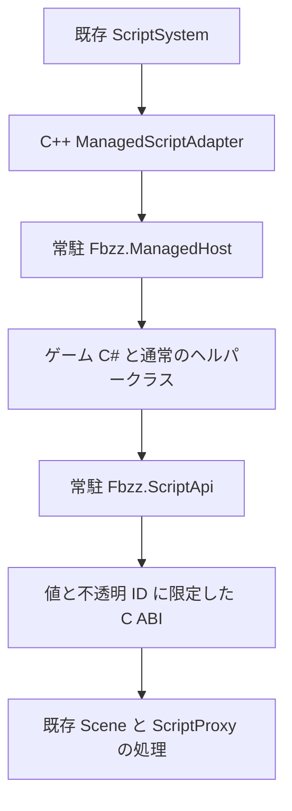
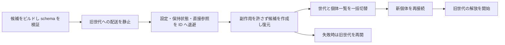

<!-- @file    csharp-scripting.md -->
<!-- @brief   C# ゲームスクリプトと既存 C++ エンジンの接続契約。 -->
<!-- @author  Hasegawa Jin -->
<!-- @date    2026-10-03 -->
# C# ゲームスクリプトの設計

- 状態: 2026-10-06、C# をゲーム Script の唯一の作者向け言語とする。C++ は Engine 実装と C# bridge を担い、native gameplay Script の authoring / registration / DLL reload は現行 SDK から除去する。受入検証は [Managed の検証記録](../../Projects/Managed/README.md)を参照する。

ゲーム作者が少ない定型でロジックを組み立て、保存から動作確認までを短くするため、標準 C# をゲームスクリプトの入口とする。Scene、GameObject、更新順、物理、描画、アセットの所有者は既存 C++ エンジンとする。方針は [C# 専用 gameplay](csharp-only-gameplay.md)に記載する。

実装済みの範囲と実行入口は [Managed の README](../../Projects/Managed/README.md)を参照する。[作者向け作成契約](csharp-authoring.md)に従い、Edit / Play の候補検証と差し替えを行う。製品では同梱 Host を Scene 読み込みより先に起動する。

標準 C# の型検出、引数なし lifecycle、public 設定と private + Setting を既存 Inspector / 保存 / ScriptSystem へ接続している。段階 2 で導入した型 GUID・参照・共通設定に加え、現在は以下の範囲を公開する。

| 実装済みの機能 | 現在の範囲 |
|---|---|
| 型の保存 | .cs.meta の型 GUID、全宣言元の compiler metadata、厳密な sidecar 照合。表示と入力はクラス名 |
| フィールド | bool / 整数幅別 scalar / float / double / decimal / char / string / enum / Vector2/3/4 / Quaternion / GameObject / ComponentRef / DataAssetRef / 対応 Material・Texture asset ref、対応 collection と Serializable class / struct |
| 参照 | CLR null と失効 GUID の区別、順序・重複・null slot の保持、任意の RequiredReference |
| 取得と操作 | Component 基底、GetComponent<T>() / GetComponents<T>()、AddComponent<T>() / RemoveComponent<T>()。managed Script と公開 native Component facade、呼び出しは通常の C# |
| 移動と検索 | Transform の位置・回転・拡縮、Objects の一括位置操作、Scene.TryFind / FindAll / ReadObjects、GameObject.TryFindChild と子孫検索 |
| Editor / AI | 名前・path・root / tag / scope による script.configure.preview / apply、配列編集、一回の Undo |
| 通知・差し替え・配布 | 所有者付き Jobs / Events、Connect / AfterReload / ReloadRetired、Edit / Play の候補適用、Managed package と SDK API catalog |

生成・破棄、Prefab 一括生成と pool、RigidBody と Collider、filtered Physics 検索、衝突通知、Animator / Audio / UI / Camera / Navigation / CharacterController も既存 C++ 処理へ接続した。具体的な名前・署名・利用 Phase は現行 `script.api.catalog` と SDK を正本とする。実装済みと検証済みは区別する。

## 設計の目的

通常の C# クラス、インターフェース、ジェネリクス、コレクションと、エンジンが編集・保存する宣言を分ける。ヘルパークラスには登録もアタッチも要求しない。エンジンへ公開する Script と DataAsset は自動検出し、作者に登録リストを書かせない。

成功は、同じ敵 AI、UI、カメラを作るときの定型コード、参照の接続、保存から反映までの手間が減ることで判断する。実行速度の倍率を計測前の採用根拠にしない。

作者向け API は、AI が有効な API と実行条件を確認できること、処理順・状態・副作用を読めること、変更箇所と反復作業が少ないことを基準に選ぶ。具体的な書き方と比較は [C# 作者向け API](csharp-authoring.md)を正本とする。

宣言から生成する設定 schema、共通の Script.Configure Op、適用世代の確認、保存と Playtest の一往復は [AI の Script 制作経路](ai-script-workflow.md)を正本とする。追加と参照設定を公開前に完成させ、Inspector と AI が同じ検証・Undo を使う。

| 参考 | 取り込む設計 | FBZZ での接続先 |
|---|---|---|
| Unity | アタッチできる C# 型と、宣言した設定の編集・保存 | ScriptComponent、Inspector、SceneSerializer、Prefab |
| Godot | 型付きデータ、通知、小さい部品を組み合わせる制作 | DataAsset、イベント、Prefab、ゲーム側のヘルパー |
| RE ENGINE | C++ 基盤と C# ロジックの分離、開発時と製品版の別評価 | 標準ランタイムでの試作と実測後の配布判断 |

参考となる既存機能は、[Unity の保存への統合](https://docs.unity3d.com/6000.3/Documentation/Manual/script-serialization-how-unity-uses.html)、[Godot の Resource](https://docs.godotengine.org/en/stable/tutorials/scripting/resources.html)と[C# signal](https://docs.godotengine.org/en/stable/tutorials/scripting/c_sharp/c_sharp_signals.html)、[カプコンの 2017 年公開資料](https://www.docswell.com/s/CAPCOM_RandD/KQQWMK-2022-07-15-133419)に基づく。FBZZ への対応は本設計の提案である。

## ランタイムと責務

初期対象は Windows x64、標準 CoreCLR、.NET 10 LTS とする。SDK とランタイムの検証済みバージョンを配布単位で固定し、プレビュー言語機能は既定にしない。.NET 10 の LTS は[Microsoft のサポート方針](https://dotnet.microsoft.com/en-us/platform/support/policy/dotnet-core)で確認できる。

CoreCLR、`Fbzz.ManagedHost.dll`、`Fbzz.ScriptApi.dll` はプロセスに常駐する。ゲーム DLL と差し替え対象の依存 DLL を collectible AssemblyLoadContext に置く。ゲーム側の ScriptApi 参照は必ず常駐する同一アセンブリーへ解決し、二重ロードを拒否する。

Editorの古いビルド世代は所有ledgerの直下だけを削除し、使用中の世代・Playで退避した世代・コンパイル候補を残す。新しい削除要求と、削除できなかった世代の定期再試行はPlay/PauseとStopの復元中に投入せず、Editへ戻った後または終了時へ延期する。退役済み候補と出力rootを値で渡し、パスの検証と削除はTaskSystemのworkerで行う。要求は同時に一件だけとし、通常のTickでは完了済み結果だけを回収する。回収後の所有ledger保存もworkerへ送り、次の回収要求より先に完了する。使用中の世代を削除候補へ入れず、投入後の退役済み候補をactiveへ戻さない。project切替・終了・サービス破棄と、新しいビルドの所有を同期保存する境界だけはworker完了を待ち、別projectのledgerへの反映や古いledgerによる上書きを防ぐ。collectible世代のランタイム回収は引き続き行う。削除できないDLLの同期I/OをEditやゲームの毎フレーム処理へ混ぜない。

Microsoft のホスト API は C++ プロセスから .NET を起動でき、同一プロセスで使うランタイムは一つである。Host、ScriptApi、native bridge の互換性を変える更新は Editor / ゲームの再起動を伴う。[Microsoft のネイティブホスティング](https://learn.microsoft.com/en-us/dotnet/core/tutorials/netcore-hosting)

依存方向は既存の `Editor / GameHub / Game → Engine → Physics / Fluid → Math` に合わせる。ホストとランタイム検出は Engine の非公開部分に閉じ、Physics / Fluid / Math に .NET の依存を追加しない。Editor はビルド・診断・操作を担当し、製品版でも使う Script の実行処理を所有しない。

REVM、FrameGC、IL から C++ への変換器は初期実装に含めない。作者の記述量を評価する前に独自の言語処理系を開発する範囲を増やさず、製品版もまず CoreCLR で評価する。

## 作者が書くコード

作者向けの正本は [C# 作者向け API](csharp-authoring.md)とする。引数なしの通常メソッド、任意の namespace、自由な名前の GameObject フィールド、GameObject[] を使う。Context 引数、固定名 Self、Ref<GameObject> の逐次解決は作者の必須定型にしない。ゲーム側は参照型に nullable の記号を付けない表記を既定とし、未設定は通常の if で扱う。以下の移動は段階 1 の API で記述できる。

~~~csharp
/// @file    MoveForwardComponent.cs
/// @brief   ローカル前方へ一定速度で移動する。
/// @author  Hasegawa Jin
/// @date    2026-10-03
using Fbzz;

class MoveForwardComponent : Script
{
    public float moveSpeed = 4f;

    protected override void Update()
    {
        Vector3 displacement = Vector3.FORWARD * moveSpeed * Time.DeltaSeconds;
        Transform.TranslateLocal(displacement);
    }
}
~~~

登録マクロ、登録リスト、反射関数、生成ヘッダーの include は作者に要求しない。通常の C# 継承は利用でき、アタッチ対象は Script 派生の具象・非ジェネリック・非入れ子型とする。通常クラスやジェネリック型の使用まで制限しない。

public / internal の対象型と non-public fieldを検出し、既定のアクセス修飾でも初期化できる factory を用意する。lifecycleは基底Scriptのprotected virtualをprotected overrideで実装する。public / sealed のクラス宣言を必須にしない。対応した public instance field は属性なしで設定・保存し、private を設定にする場合だけ Setting を使う。自己参照は基底の GameObject / Transform、変数宣言は明示型を推奨する。属性の旧名や省略した型を別の Script 構文へ変換しない。

C# ゲームコードの namespace は任意とする。省略したグローバル名前空間でも、作者が選んだ名前空間でも検出する。sandbox を必須にしたり、生成器がソースを名前空間へ包み直したりしない。型の解決には実際の CLR 完全修飾名を使う。

callbackの共通契約からSDKのprotected virtual宣言、Hostの対応表、Analyzerの規則を生成する。ゲーム作者は必要なcallbackだけprotected overrideで実装し、名前・署名の誤りは通常のC#コンパイラで拒否する。override欠落・static / async等もビルド時に診断する。Update / FixedUpdate / LateUpdate、Awake / Start、OnEnable / OnDisable / OnDestroy、Connect / AfterReload / ReloadRetired は引数なしとする。衝突・Trigger は対応する payload、Jobs / Events は登録したdelegateをHostの配送入口で呼ぶ。catalogのlifecycleCallbacks / lifecycleAuthoringも同じ契約から作り、配布SDKだけで規約を取得できる。

呼び先は候補ロード時に解決し、世代が所有する dispatch 表へ置く。通常フレームでメソッド名の反射検索を繰り返さない。世代終了時に delegate とゲーム型への強参照を解除する。

Time / Input / Scene / Objects / Jobs / Events / DataAssets は Script に結び付く instance の窓口とする。Host の入口ごとに実行元・コード世代・呼び出し ID・callback を持つ内部スコープを作る。通常の別 Script の public call は実行元を切り替えず、現在の権限を使う。対象 Script 固有の窓口では対象の生存・世代・Scene も検証する。登録仕事・購読の owner はサービスを持つ対象 Script であり、呼び出し元と区別する。作者向け Context と同じ操作の別名 API を併設しない。

コンストラクターとフィールド初期化は既定値と通常の managed データを作る。構築中に Engine API は使えない。Host が自己参照の GameObject を所有者 ID から提供し、Transform は操作時に実行スコープと対象寿命を照合する facade にする。通常の設定は保存値・初期化子、Scene の対象検索は Start 等の通常コード、Editor 接続は共通 Op で扱う。Attached / SceneObject / SceneObjects の初期接続属性は導入しない。保存済みの未設定・空配列・欠損を検索結果で上書きしない。

## 属性と保存の役割

対応した public mutable instance field は設定・保存対象とする。FBZZ の SettingAttribute は private の設定公開、または任意 metadata の追加に使う。Unity の public 既定保存と SerializeField を参考にするが、UnityEngine の型や属性へ依存しない。[Unity の SerializeField](https://docs.unity3d.com/6000.0/Documentation/ScriptReference/SerializeField.html)

| 宣言 | 通常 Inspector | ディスク保存 | Play 差し替え |
|---|---|---|---|
| public の対応 field | 編集可能 | 保存する | 現在値を引き継ぐ |
| private の対応 field | 非表示 | 保存しない | 既定値から作る |
| private + Setting | 編集可能 | 保存する | 現在値を引き継ぐ |
| private + KeepOnReload | 非表示 | 保存しない | 現在値を引き継ぐ |
| public + NonSerialized | 非表示 | 保存しない | 既定値。KeepOnReload を併用可能 |
| public property | 自動評価しない | 保存しない | 自動復元しない |

直接の GameObject / Component 参照 field は private / NonSerialized でも、Play 差し替えで属性なしの参照再接続を行う。上表の private が既定値へ戻る規則は通常の数値等に適用する。対応した public GameObject[] 等の保存 codec の値復元は、任意の collection の自動再接続を除外する規則で無効にしない。

public は通常の C# 外部アクセスも許す。制御を分けたい作者は private + Setting、状態の参照は public getter、変更は public メソッドを選べる。public を選んだ全代入を Engine が監視するとは扱わない。設定の変更入口と runtime の通常コードは区別する。

自動設定の走査はゲームが宣言した field を対象にし、Script SDK のサービスは含めない。static / const / readonly、property は自動保存しない。非対応型の public mutable field は設定・保存から除外し、警告と catalog の理由を返す。通常 C# の使用とアタッチ公開は拒否せず、NonSerialized を付ければ非保存の意図を明示できる。明示した Setting / KeepOnReload が非対応型・static / const / readonly・property に付いた場合も診断する。

public と Setting は一個の設定として扱う。Setting と System.NonSerialized は競合として拒否し、NonSerialized と KeepOnReload は「ディスク非保存・Play 状態保持」として併用できる。保存対象と KeepOnReload の重複は snapshot を一回だけ取る。これらは FBZZ の保存規則で、.NET の汎用シリアライザーを呼ぶ指定ではない。

Setting の Label / Help / Group / Unit は任意の編集 metadata。Visible = false は Inspector 表示だけを隠し、保存と AI catalog は維持する。表示名の既定生成では m_ を除くが、保存キーは変えない。永続キーの既定はメンバー名、明示指定は FieldKey、改名互換は PreviousFieldKey。重複・曖昧な移行を診断する。

ValueRange / RequiredReference は明示した追加条件だけに使う。参照型の表記や public から必須参照を推論せず、範囲を省略した数値にはゲーム固有の上限を作らない。float / Vector3 / Quaternion は有限、enumは宣言値、明示ValueRangeは範囲内を要求し、codec・型・数値の制約は全段階で一括検証する。SettingsValidationPurposeのAuthoringは作成・編集途中の必須参照未接続を許し、Snapshotは保存・Undoの未接続状態を保持する。RuntimeはPlay開始・reload候補に生存する単体参照、または非空かつ全要素が生存するcollectionを要求する。RequiredReferenceの未接続を型catalogの登録拒否にはしない。入れ子のschemaにもrequiredReference / requiredAt: Runtimeを載せ、失敗は型とfieldのleaf pathを診断し、暗黙に丸めない。DataAsset読み込みも同じcodecの型・値検証を使う。実行中の代入はゲームロジックとEngine APIの契約に従う。

読み込み失敗は raw fields を保持した Missing 状態にし、既定値で保存し直さない。Inspector の失敗は旧値、候補の失敗は旧個体・値を維持する。途中まで書き戻さない。

Debug inspect は対応した private field も属性なしで読み取る。getter と任意のユーザーコードを自動評価せず、未対応値は型と取得不可の理由を返す。更新スコープを作ったりワールド変更を許可したりせず、差し替え中・復元中の途中状態を公開しない。Watch は初版へ導入しない。

現在の保存 codec は bool、各幅の整数、float / double / decimal / char / string、整数基底 enum、Vector2/3/4、Quaternion、GameObject、ComponentRef<T>、DataAssetRef<T>、対応 Material / Texture asset ref と、対応 collection、Serializable class / struct を扱う。null と collection の規則、wire 表現、循環・未知キー・重複キー・非有限値の拒否条件は [共通 field schema](csharp-schema.md)を正本とする。Dictionary、framework 基底や独自 collection は対象外。ロジックの通常 C# と保存対応型は分ける。

Play 中の保存対象と KeepOnReload の現在値はメモリー snapshot へ退避し、編集用 Scene ファイルを書き換えない。Play 開始・終了の authoring 状態の復元は既存 SceneSerializer の契約に従う。

## 型の識別と登録

保存する型 ID は `cs:<型 GUID>` とし、既存 ScriptComponents の type 欄を使う。重複した GUID は上書きせず拒否する。

型 GUID は `.cs.meta` の `[[managed.types]]` で管理し、`[meta] guid` のファイル GUID と区別する。同じファイルに複数型を置く場合は型ごとに別 GUID を持つ。単一宣言元は自動発行する。partial 型は全宣言元に既存 mapping が一つある場合に採用し、新規の複数ファイルでは明示 primary mapping を要求する。同じ型へ複数 GUID が付いた場合は候補のインポートを拒否し、旧世代を保つ。通常のヘルパークラスは型一覧へ登録しない。

Editor のインポート時に新しい型へ GUID を発行する。型名の変更では mapping の clrName を更新し、previousClrNames に旧完全名を残して同じ GUID を維持する。主宣言の移動・分割も同じ GUID を明示して移す。削除した型の mapping は tombstone として保持する。コンパイルのたびに GUID を再発行せず、曖昧な改名や移動を型名から推測しない。内部試作の cs-internal 型キーは現 CLR 完全名が一致する場合だけ移行し、旧 CLR 名の改名履歴による自動移行は保証しない。

CLR 内の解決情報は論理アセンブリー名と完全修飾型名とする。DLL パス、アセンブリー版数、CLR の Type は永続 ID にしない。現在の `<DLL fullpath>.scripts.json` は schemaVersion / assemblyName と、Script / DataAsset 型ごとの id / clrName / primarySource / sources を持つ。sources は path / line / contentHash で、BOM を含む compiler source bytes の SHA256 と現在のソースを照合する。field schema と callback は Host の catalog で検証する。SDK 公開型・署名の `script.api.catalog` は型 sidecar と別の読み取り口である。

構文エラーやビルド失敗の間は、型が見つからないことだけを理由に .meta の型 GUID を削除しない。成功した型情報とソース版からインポートを確定し、同じ版の .meta と manifest を候補へ付ける。

候補 catalog は世代単位で検証し、検証途中の型を公開しない。ScriptFactory は managed catalog を ScriptEntry へ接続する。

## 既存スクリプトへの接続

`ManagedScriptAdapter : fbzz::scene::Script` を native 側に置き、既存 `ScriptEntry::unique_ptr<Script>` に格納する。Adapter は managed 個体 ID とコード世代を持ち、callback、Reflect、要求メタデータを転送する。C# 専用の Scene、Component 配列、更新ループは追加しない。

| 既存の責務 | C# の接続 |
|---|---|
| ScriptSystem | 同じ GameObject 内の ScriptEntry 順で managed Script を実行 |
| ライフサイクル | 既存の全 Awake 後の Start、無効化、破棄の規則を利用 |
| Phase | Update、FixedUpdate、LateUpdate は既存の Script phase と物理前通知に接続 |
| 編集時実行 | ExecuteAlways 属性を既存 opt-in へ変換。編集中の物理 callback は呼ばない |
| requirements | Component / Script / GameObject 参照 / Asset の要求を既存診断へ投影 |
| 障害 | managed 入口の失敗を既存の Script 停止状態へ反映 |
| 反射 | managed 値を native 一時値へコピーし、既存 Inspector / Serializer へ渡す |

native OnEnable と OnAwake の順も含め、通知順は現行 ScriptSystem に合わせる。Unity と同じ順序という新しい保証は追加しない。required Component は自動追加しない。開始時検証後の相手の破棄は GameObject.IsAlive または一括 API の要素 status で扱う。[初期化と必須設定](greenware-script-feedback.md)に従う。

Awake / Start / 有効化 / 無効化 / 破棄も専用の入口として検出し、初期化を Update 内の一度だけの分岐へ押し込まない。Time.DeltaSeconds は Update / LateUpdate でフレーム差、FixedUpdate と衝突・Trigger 通知で固定時間差とする。開始、その他のイベント、延期完了では時間積分用の差を公開せず、利用を診断する。

native Component facade は公開された Component 型を通して Engine 部品へ接続する。managed Script の取得は managed ID から CLR 側で行い、C ABI を越えて CLR object や Engine 内部型を渡さない。

C# 同士の継承・インターフェース参照は CLR 側で判定する。ゲーム固有の通知は共有 schema の型付きイベントと値データで接続する。

SDK の Script は managed Component 基底を継承し、GameObject.GetComponent<T>() where T : Component と Script 自身の GetComponent<T>() へ取得口を統一する。公開対象は Script 派生型と SDK に登録した native facade 型。C++ の内部型は公開せず、型 schema が managed ID 取得 / native binding を分ける。初版は Component 基底そのものの異種全件取得を対象にしない。

managed Script は有効な照会スコープ・メインスレッド・同じ Scene・生存 GO・公開済みの現行世代・CLR 型一致を確認し、ScriptEntry の順序で最初の一致を返す。零個 / Missing / 失効は null。GetComponents<T>() は同順序の通常配列、零個なら空配列とする。native facade は登録した Component 型の取得へ接続する。別 Scene / 不正スコープ等の拒否は診断を返し、未検出と区別する。開始済み・enabled / faulted / requirementsBlocked は取得条件にせず、初期化完了の保証も付けない。C ABI で CLR object を渡さず、managed ID から CLR 側で取得する。

native facade は取得時の Component birth token を保持する。除去・再追加で旧参照を復活させず、新しい個体は明示的な GetComponent で取得する。除去予約は Get / 存在照会 / lifetime 照会から即時に隠し、同型 Add は Cleanup が完了するまで理由付きで拒否する。次の callback が必ず Cleanup 後とは限らない。剛体変更は Play の FixedUpdate のみ、Physics 検索と衝突・Trigger の型付き配送は既存 World / PhysicsSystem へ接続する。生成中の constructor / 設定復元には外側の managed scope を渡さず、戻ると復旧する。生成・破棄・物理の詳細は [作者向け契約](csharp-authoring.md#生成破棄と-physics)を参照する。

GameObject.UI / Script.UI と GameObject.Audio / Script.Audio は所有者サービスであり、Component ではない。UI は必要な実 widget row を操作ごとに解決し、Audio は主 AudioSource を要求しない 2D 再生・合成音資源・所有 loop を扱う。実 AudioSource と UIText / UIImage / UIButton 等は birth token を持つ Component で、それぞれに関係する操作だけを公開する。UI の旧 Component 番号 7 は予約し、Get / Add / Remove の公開型対応から外す。サービスそのものは差し替え状態へ退避せず、所有者 property から再取得する。

native Component の Equals / hash / == は Scene lifetime・ObjectId・型番号・birth token、Transform は所有者 identity の純粋な比較とする。Engine scope を要求せず、失効で CLR null と同一視せず、失効後も同じ取得時 identity の等価性を保つ。Script は CLR 個体の参照等価性を保つ。native object token は Scene / Entity generation / GUID の逆索引で解決し、破棄・Clear・Scene destructor で所有記録だけを回収する。終了通知は CLR や未初期化 singleton を呼ばない。

GetComponent は通常配列を組み立てず、内部の ScriptEntry page を型照合して最初の一致で止める。GetComponents の通常戻り値は全件の所有配列。GetComponents<T>(Span<T?>) は呼出元が capacity を選び、Required / Written を返す。不足時は全件の Required と Written=0、出力未変更。成功時は全件と順序を保ち、未使用の末尾は変更しない。count と copy は同じ同期スコープで user callback を挟まない。転送 packet の 64 ID 制限を集合件数の上限にはしない。CLR 型照合 cache はコード世代へ閉じ、退役時に破棄する。型 cache 初期化後の caller-buffer 経路は集合の一時配列を確保しない。native facade cache は各 GO の型番号と birth token をキーにする。

Animator.GetCurrentBlendWeights(Span<BlendWeight>) も同じ capacity 契約。native が既存の blend 配列を同期借用し、必要な範囲だけを転送する。小さい bridge packet は stack storage、大きい read-only 結果は最大 64KiB の再利用 packet で順次復号する。32768 件や 16MiB の total 制限を設けない。非空の名前は戻り値の所有文字列として確保し、packet の記憶域を外へ残さない。pool の初回確保後に転送・集合の一時配列を追加確保しないが、公開の全件配列・文字列自体は選択した API の戻り値として確保する。通常の CLR 配列 / string が表現できない値は理由付きで拒否し、黙って切り詰めない。変更要求は容量不足で再送しない。

普通の C# call に callee の Host スコープを作らない。A の callback から B のメソッドを呼んでも Phase / RunMode / 権限 / DeltaSeconds は A の現在の入口のまま。B 固有の GameObject / Scene / Events / Jobs 等の窓口は B の生存・現行世代・Scene も照合し、登録 owner を B にする。GameObject は共有可能な非所有 ID 参照で、そこからの操作は現在の A の権限を使う。enabled / faulted の自動配送停止を、明示した managed メソッドの全実行禁止と同一視しない。停止 owner の購読・仕事は配送を迂回せず、faulted / requirementsBlocked owner の新規登録を拒否する。

取得した Component / Script は通常の field / local / collection に保持でき、Awake で取得して使い回す書き方を標準にする。managed Script 実体は現行コード世代に属し、native facade は非所有の寿命 ID 参照。Play 差し替えでは Script の直接の mutable instance field の GameObject / Component 参照を属性なしで再接続する。static / 任意の object graph / collection / Task / delegate の中は自動再接続せず、世代をまたぐ保管を診断する。async void の公開ゲーム操作も診断対象とし、通常の helper の非同期計算まで禁止しない。Engine は所有者付きサービスから新しいスコープで再入する。

通常 call 全体の状態変更、再入、例外を自動で囲む保証は外す。同期例外が最外の Host 入口へ伝わった場合、その入口 A を停止する。B のみの停止・rollback・自動再送は約束しない。外部保管先に残る旧 raw T の純 managed 更新を完全禁止できず、owner-free GameObject を持つ古いメソッドが新 callback 内から実行される形も型だけでは防げない。Host が再接続する field 以外への世代をまたぐ保管は SDK の対応範囲外。旧世代の Host 配送・サービス token・スコープ外の要求は拒否する。

前 Draft の TryGetScript / TryCall、所有者切り替え、単一操作 lambda と IL call site の必須検証は取り下げる。単純なゲーム操作を普通の C# として書けることを優先し、この範囲を [作者向けの型付き操作](csharp-authoring.md#他の-script-を型付きで操作する)と共有する。

## API 境界と参照の寿命

native 側が呼ぶ関数ポインターは常駐 Host の入口に限定する。差し替えるゲーム DLL の関数ポインター、Type、FieldInfo、delegate を native 側や常駐 cache へ直接残さない。Host は個体 ID とコード世代から呼び先を引く。

C ABI が受け渡すのは固定幅の値、明示レイアウトの数値構造体、不透明 ID、長さ付き UTF-8、呼び出し側が用意したバッファである。Script、GameObject、IReflector の native ポインター、std::string、std::vector、C++ Math 実装型をそのまま渡さない。bool、enum、packing、サイズ、alignment、文字列の所有者を ABI schema で固定する。

Host と native の固定境界は共通定義の VERSION / SCHEMA_HASH、request / reply のサイズと offset を呼び出し開始前に検査する。操作は共通定義の番号で dispatch し、既存番号を別の意味へ再利用しない。保存用 field schema の版は固定境界の版と別に扱う。

| 内部境界の役割 | 受け渡すもの |
|---|---|
| Initialize | ABI 情報、native API table、診断用の固定入口 |
| LoadCandidate / PrepareInstances | ビルド世代、manifest、所有者 ID、設定と復元値 |
| TryInvoke | 個体 ID、コード世代、callback ID、値引数 |
| ReadFields / WriteFields | 個体 ID、field key、型 tag、値バッファ |
| Commit / Retire / ReleaseOwner | 検証済み世代または所有者 ID |

戻り値は固定幅の status とし、成功、無効 ID、旧世代、未接続、別スレッド、型不一致、必要機能なし、managed callback 失敗を区別する。バッファ不足は必要長を返し、部分成功にしない。C++ は bool と Logger。C# の通常取得は GetComponent の nullable 戻り値等に変換し、バッファ操作の成功判定には Try 系を使う。

表は内部処理の役割を示すもので、ゲーム作者向けの公開メソッド名ではない。正確な操作番号と packet は ManagedBridgeContract.inl、公開 C# の署名は script.api.catalog を正本とする。

GameObject ラッパーはフィールド・配列へ保持できる非所有参照とする。GUID と、対応付け済みの不透明 ID を持ち、native テーブルで Scene の寿命と Entity の世代へ照合する。C# の GC がラッパーを回収しても GameObject は破棄しない。破棄は既存 Scene API による明示操作とする。解決できない GUID は保持し、IsAlive を false にする。未設定の CLR null と区別する。

native は Host への自己 GO 接続に成功した世代・個体・所有者・Scene 寿命・Entity・不透明 ID・GUID・Script birth を保持できる。公開中の世代で callback 実行中でなく、生存確認と全 identity が一致するときだけ同じ接続の再送を省く。再入・未接続・旧世代・identity 変更は Host で再検証し、直接の接続操作と個体解放は個体 ID、世代退役は世代 ID、Host 終了は全件で成功記録を失効させる。接続の再送を省いても、callback ごとの新しい CallId と実行 scope、API 要求の権限検証は省かない。

保存は GameObject GUID、型 GUID、アセットの guid: を使い、実行時 ID とコード世代は保存しない。未設定・破棄済み・型不一致を区別し、GUID / 名前 / タグによる単体接続の複数一致では先頭を暗黙に選ばない。GetComponent の最初の型一致を返す規則とは別の契約。GameObject[] は GUID 列として順序・重複・未設定・欠損スロットを保持する。

native Component facade は GameObject の Scene / Entity 寿命を検証する現行 Component の view とする。同型を削除した間は IsAlive が false、再追加後は現行 Component を操作する。GameObject の破棄・同 GUID の再生成では旧 view を復活させない。managed Script は個体とコード世代の寿命も確認する。GameObject の値比較は Scene と実行時寿命 ID を使い、CLR null と破棄済み参照を同一視しない。

public の型付き Component field のディスク保存は初版の正式 codec に含めず、非対応理由を catalog に示す。Scene / Prefab の接続は GameObject GUID を使う。private の Component cache と Play 参照再接続はディスク保存と別の機能として扱う。

すべての ScriptApi 操作に現在の実行元とコード世代を関連付ける。Script 固有のサービスには、そのサービスを所有する個体の ID / 世代も付ける。古い Task や callback の要求、旧サービス token を拒否する。Scene 破棄とコード差し替えは別の失効条件である。

Host はユーザーコードを呼ぶ前に Prepare / Live / Cleanup の実行スコープを設定する。各 bridge 入口はラッパーの ID に加えて現在の実行スコープを検証し、Script 固有サービスでは受け手 owner も照合する。普通の helper / public call は現在のスコープを使う。候補のロード、static 初期化、構築、復元には Prepare を使い、既存ラッパー経由も含めて Engine API を拒否する。Cleanup は managed 後始末だけを許し、ワールド変更を拒否する。スコープ外の操作も拒否する。

GameObject / Transform / Component の参照は長期間保持できるが、各操作は現在の呼び出し元の有効な実行スコープ・対象の寿命を検証する。参照には取得時の Phase / 権限 / 呼び出し ID を保持しない。bridge 要求には操作時の呼び出し ID を付け、過去の callback / Task が現在の Live スコープを作れる仕様にしない。caller バッファや Span 等の借用 view は指定した呼び出し限りとする。GameObject / native Component ラッパーには生成した Script の owner を束縛せず、raw Script の世代寿命は型付き操作の契約に従う。

初期版の Engine API はメインスレッド限定とする。通常の C# 計算は別スレッドで実行できるが、結果は所有者・コード世代を照合する配送口で受け取る。任意の Task.Run をホットリロードが強制終了する保証は付けない。

## 階層参照の接続

GameObject の Parent、直下の子、子孫、root 相対の名前セグメント・タグ検索を、保持可能な GameObject と通常配列へ投影する。単体は全一致数を確認し、native FindInSubtree の「自分を含む・最初の一致」をそのまま公開しない。動的検索の root と Scene は明示し、接続・生成・関係変更時に利用する。

深い通常階層でも、解決済み参照の利用に親・名前パスの再走査を要求しない。検索は反復処理と訪問数検証で行い、読込時に循環・無効リンクを拒否する。既存の子孫破棄・Prefab 差し替え・Editor 検索に残る再帰を含め、数千段の安全性は未確認。公開前の検証範囲と Transform / active 判定の費用は [深い階層の契約](csharp-authoring.md#深い階層と処理コスト)に従う。

初版は階層の派生属性や自動依存解決を追加しない。Editor の選択 root と結果 GUID を一括 Op 計画へ持ち、public または Setting の参照をまとめて設定する。保存した各参照は独立で、別フィールドの変更に追従して黙って書き換えない。作者向けの名前・範囲・順序は [階層参照の契約](csharp-authoring.md#子オブジェクト参照で不足していた契約)を正本にする。

現行 PrefabInstantiate は子を含む実体名を UniqueName で変えるため、Prefab 内の固定参照は source GUID へ解決して保存する。ScriptComponents.fields の単体・配列 GUID を既存の生成時再帰リマップと Prefab Apply の逆変換へ接続する。実体名検索、source 定義の選択、永続 GUID 参照は同じ操作として扱わない。

動的な部位検索は現在の `GameObject.FindPrefabPart(sourceId, includeInactive)` を使う。指定 root 自身と子孫の prefabSourceId 一致を配列で返し、別 root を Scene 全体から補わない。名前の定義経路を自動で source GUID へ変換する TryFindPrefabPart は公開していない。入れ子の個体を含む複数一致も一件へ推測せず、必要な instance root を作者が明示する。固定参照は GUID 保存を使う。

## ScriptProxy と生成する API

座標、単位、失敗時の値、所有者は既存 Engine の契約を正本にする。position はローカル、worldPosition はワールド、書き込みは親子の world 値を即時同期する。[Transform の契約](script-transform-contract.md)を C# API と native 実装で共有する。

C# では LocalPosition / WorldPosition を通常の読み書き property にし、Transform.WorldPosition = position と書ける。setter は既存の座標変換・入力検証・親子即時同期へ接続し、独立した SetLocalPosition / SetWorldPosition を重複公開しない。LocalPosition は親座標、TranslateLocal は自分の軸による移動量、TranslateWorld はワールドの移動量とする。Rotate(axis, degrees) の角度は度、Quaternion の生成角度はラジアン。DeltaSeconds は該当フェーズの秒単位の時間差。この facade と既存 Proxy の対応を binding schema に記録し、通常 Transform の setter で物理 body を移動しない。

MoveTowardsWorld は段階 2 の共通 helper で、最大移動量と停止半径をメートル単位で受ける。時間を内部で掛けず、入力検証後に既存 world 更新を使い、座標・即時同期・物理の制約を変えない。追跡・巡回等のゲーム判断は C# 側へ残す。参照の検索 Try API は成功時の非 null を標準 nullable 注釈へ記録する。GetComponent は未検出で null、GetComponents は非 null の T[] を返す。通常の作者例は T と if の表記にし、nullable を使う SDK の署名・metadata と catalog には null 許容を正確に記録する。作者が明示型の out 変数をそのまま使えるようにする。

C# の Vector / Quaternion は値型で、通常の数値計算を managed 側で完結させる。自作 Math の座標系・角度・数値契約との対応を検証する。Transform、raycast、アセット操作などは native の既存処理へ転送し、物理や描画のアルゴリズムを複製しない。

### C# API と Engine 実装の境界

作者は `Fbzz` の型とメソッドを使い、Engine 状態を操作する API は既存 C++ の処理へ接続する。通常 class の helper も同じ窓口を使う。公開する名前、型、単位、座標、所有権、失敗条件、実行スレッドを一つの契約で管理し、作者に P/Invoke、native pointer、別の計算型への変換を要求しない。

CAPCOM の GCC 2017 講演では、Clang による C++ クラスの C# 公開、C++ / C# の統合したインスタンスモデル、開発用 interpreter と製品用 IL2CPP の呼び出し経路が説明されている。この公開契約の一元化を参考にする。資料の公開日は 2022 年であり、現在の RE ENGINE の実装を示す資料とは扱わない。[RE ENGINE の設計、57–64 ページ](https://www.docswell.com/s/CAPCOM_RandD/KQQWMK-2022-07-15-133419#p57)

FBZZ の CoreCLR は REVM と異なるオブジェクトモデルを持つ。C++ 型から C# がそのまま継承できる仕様や、マーシャルが無費用になる保証は導入しない。C ABI と不透明 ID の境界を維持し、呼び出し回数と受け渡すデータ量を評価する。ゲームコード側で統一するのは API と意味であり、すべての足し算を native 関数に変える方針ではない。

| 処理 | 実行場所と契約 |
|---|---|
| 追跡対象の選択、状態機械、戦闘ルール | 通常の C#。Script から普通の helper やクラスへ分割できる |
| Transform、物理問い合わせ、Navigation、Audio、アセット | 既存 C++ の処理へ固定 ABI で接続。公開型・署名・利用条件は SDK catalog を参照 |
| 数値・Vector の小さな純粋計算 | C# の値型で完結。自作 Math と同じ数式・境界条件を検証して公開 |
| 大量の Transform / 生成・破棄 / 検索 | 一括位置操作、CreateMany / InstantiateMany / DestroyMany、caller buffer 検索を C++ へ接続。物理の全件検索は結果配列を返し、物理変更をまとめる汎用 batch API は公開していない |

Unity も Vector3 の Dot、Cross、Distance 等を C# の計算として公開している。[Unity 公式 C# source](https://github.com/Unity-Technologies/UnityCsReference/blob/master/Runtime/Export/Math/Vector3.cs)。小さい計算は JIT のインライン化対象になり、各演算で native 境界を越える必要がない。具体的な速度差は Release の実測前に保証しない。

### 計算関数の公開順と一致条件

現行の C# Vector3 は float の X / Y / Z、ZERO / ONE / RIGHT / UP / FORWARD、Length / LengthSquared、加算・減算・符号反転・スカラー乗算と除算・有限値判定・Dot / Cross / Lerp / NormalizedOr に対応する。Quaternion も XYZW の値型として FromAxisAngle / FromEuler / LookRotation、積・正規化・逆・Lerp / Slerp 等を公開する。計算は managed 内で完結し、対応条件は作者向け文書の回転節に記録する。

float 用の Mathf.Clamp / Clamp01 / Lerp / ToRadians / ToDegrees と PI / TWO_PI / HALF_PI / DEG2RAD / RAD2DEG / EPSILON を公開した。これらと Vector3 の計算は Host や native dispatch を使わず、constructor と通常 helper からも呼べる。標準 .NET の MathF も普通の C# として使えるが、FBZZ 固有の数値契約が必要な場所は SDK の関数を使う。

| 一致させる条件 | C++ 側の正本と C# の扱い |
|---|---|
| 座標・単位 | 左手系、+Y が上、+Z が前、位置はメートル、時間は秒。角度変換は関数名で明示 |
| 補間 | MathUtils.hpp / Vector3.hpp の Lerp は t を clamp しない。C# でも同じ意味にし、必要時に Clamp01 を明示する |
| 退化した方向 | Vector3.NormalizedOr は長さが EPSILON 未満なら指定 fallback。通常の追跡・視線にはこの退化入力を扱える形を使う |
| 精度・丸め | float32 の評価順と許容差を決める。std::round と MathF.Round の既定丸めは同じとは限らず、名前だけで置き換えない |
| 不正値 | NaN / Infinity、逆転区間、零除算の入力条件・失敗時の値を各関数で宣言する。既存の曖昧な挙動を無条件に SDK の契約へしない |

根拠は `Projects/Math/include/Math/MathUtils.hpp` と `Vector3.hpp`。ManagedTests は非有限値・零除算・float32 のオーバーフロー・符号付きゼロを、ManagedMathParityTests は実 CoreCLR の計算結果と C++ Math の通常値・境界値・退化入力・定数・Vector3 の配置を照合する。NormalizedOr は長さが EPSILON 未満の場合だけ fallback をそのまま返す。Clamp の区間は min <= max を前提とし、逆転区間の修正は行わない。浮動小数点の全プラットフォームでの bit 単位の一致や、ネットワークの決定性は別の要求とする。

MoveTowardsWorld は現在、C# で距離を計算し、native の WorldPosition 読み書きを使う。最大移動量・停止半径・親子同期を維持する共通 helper であり、単一 native 呼び出しや一括版としては公開していない。

`Engine/Scene/ManagedBridgeContract.inl` を両言語の固定 ABI の正本とする。C++ はマクロ展開し、既存の Roslyn compiler library は Host / SDK の AdditionalFiles から同じ定義を読み、操作番号、enum、定数、構造体とサイズ・全 field offset の定数を生成する。C++ の static_assert と managed の配置テストで ABI version 1 / Request 104 byte / Reply 72 byte を維持する。完成経路の追加で schema hash は 0x46425A5A4D414E07 に更新し、古い Host / API との組合せを拒否する。

同じ定義から位置の読み取り・書き込み・ローカル移動、raw key、delta time、回転・拡縮・方向、剛体の値の読み書き、ワールド重力とレイヤー行列の読取の Host 呼び出しも生成する。生成メソッドは既存 Request / Call を使い、同期 scope・対象の寿命検証と一回だけの dispatch を維持する。UTF-8・可変長参照・配列の経路、作者向け facade、native の処理本体は明示実装で、C++ API 全体を自動公開する機構ではない。binding を指定しないゲーム assembly ではこの生成を行わず、指定時の欠損・不正定義は compiler 診断で停止する。AI catalog は公開済みの SDK reflection と署名ごとの契約を組み合わせ、getter を評価せず生成する。

現在の公開範囲は [作者向け契約](csharp-authoring.md) の一覧と `script.api.catalog` に記録する。動的な処理は普通の C# メソッドを呼び、延期処理は Jobs、同期通知は Events を使う。独自の文字列 Invoke を必須にしない。

小さい数値操作で文字列検索や boxing を行わない。大量対象には GameObject[] と再利用する連続バッファを使う。実装済みの三つの位置操作は C ABI の ID / Scene 寿命列、件数、caller 所有の値・status バッファへ変換し、managed 配列や Span の構造をそのまま渡さない。Host は容量を超えた時だけ転送バッファを拡張し、要求は空配列を含めて一回だけ dispatch する。再送・scalar API の個別呼び出しは行わない。境界呼び出し回数、managed 確保、native 処理時間を別々に計測する。

入力上限は 32768 スロット。読み取り・共通移動の入力は一件 16 byte の object ID / Scene 寿命、位置設定は一件 28 byte の参照と XYZ。読み取り出力は一件 16 byte の uint32 status と XYZ、位置設定出力は一件 4 byte の status。Reply の index / flags は適用・スキップ数とし、失敗時に出力を部分更新しない。共通移動は値出力を持たない。配置と enum は共通定義から生成する。

一括 Transform 操作は事前検証後に入力順で既存操作を反復し、親子の即時 world 同期・手動配列の重複を維持する。位置を先に全件読んでから共通移動量を書き戻す実装は、親子を逐次移動する foreach と同じ意味にならない。欠損要素は status で示し、要求全体の長さ・Scene・フェーズ・数値のエラーは部分適用しない。

変更時は必要な姿勢だけを shadow へ複製して通常経路と共通の Transform 数式で試算し、全件成功してから Scene へ適用する。重複を逐次移動した後半の overflow と子孫同期の不正値も適用前に拒否する。読み取りは scalar WorldPosition と同じキャッシュを返し、再同期も非有限値の拒否も行わない。変更対象に enabled な実体 RigidBody が含まれる場合は要求全体を PHYSICS_BODY として拒否する。剛体の変更は Play の FixedUpdate で実装済みの RigidBody API を使う。

位置設定は有効な対象へ使う要素だけ数値検証し、失効スロットの未使用値を参照しない。通常の一括操作は inactive も指定配列どおりに扱い、TranslateWorld の activeOnly 指定時だけ呼び出し時の active-in-hierarchy で選択する。Editor 選択は inactive の条件を計画へ明示し、Scene 検索は既定で active-in-hierarchy の対象を選ぶ。

一括検索は明示した時点のスナップショットを返し、保持中の配列を自動更新しない。接続で GUID を generation 付き EntityID へ対応付け、通常の一括更新では GUID による全 Scene 検索を繰り返さない。タグ index は現行機能として仮定しない。

[Scene 容量](scene-capacity.md)は現行 4096 Entity 枠であり、配列化で拡大しない。Scene.InstantiateMany は子孫を含む必要数を検証し、ユーザー callback 前の作成段階からまとめて公開する。pose ごとに一 root を返すため single-root Prefab を条件とする。CreateMany は空 GameObject 群を作る。両方とも SpawnPose の列と caller 所有の出力バッファを受け、変更要求を容量不足で再送しない。複数 root の既存 Prefab 機能自体は変更しない。

## 通知と延期処理

ScriptEventBus と汎用 EventBus は購読ごとに一つの callable を保持し、連続した通知・同期再入でも mutable な捕捉状態を同じ実体へ蓄積する。配信リストの取り置きで callable 本体をコピーしない。購読表と進行中の配信は callback の所有を共有し、購読追加による配列の再確保や解除・Clear の後も実行中の callback を生かす。既存の選択規則は維持し、ScriptEventBus は未配送の解除済み購読を飛ばし、汎用 EventBus は開始時の購読列へ現在の通知を最後まで配る。解除後の次回通知はどちらも配らない。

ScriptEventBus と汎用 EventBus の購読 ID は Clear 後も再利用しない。ID 空間を使い切った登録は無効な ID を返し、古い解除要求を別の購読へ適用しない。ScriptEventBus の Clear は既存の個別解除と同様に旧購読を無効化し、物理的な破棄は最外の同期配送が終了した安全点へ遅延する。Clear 後の新規購読は進行中の配送へ混ぜず、次の Publish から受信する。配送先のチャンネルは開始時に確定し、呼出し側の文字列の変更を途中で読み直さない。DLL のアンロードは進行中の配送がすべて戻った後に行う。

Godot の signal を参考に、Events.Subscribe<T> / Publish<T> を既存 ScriptEventBus の同期配送へ接続する。接続は所有 Script とコード世代を持つ。通常の C# event と所有者付きサービスは別であり、signal を結線する専用 Inspector UI は現在の公開機能に含めない。

購読の宣言場所は引数なしの Connect() に集める。新規個体は既存 Start の成功後、有効な場合に一度呼ぶ。Play 差し替えでは復元・commit と AfterReload の後、開始済みで有効な個体へ呼ぶ。Connect は Events の所有者付き購読の登録と解除に限り、ワールド変更を許可しない。登録は呼び出し成功時に一括有効化し、途中の購読へ配信しない。無効化で仕事と購読を解除し、開始済み個体の再有効化では Connect を一度呼び直す。fault・requirementsBlocked の個体を自動再開せず、破棄・世代終了でも登録を解除する。

現行 ScriptEventBus の同期配送を維持する。C# の handler は実際の T payload だけを受け、Host が購読者・コード世代・新しい呼び出し ID を持つ内部スコープを配送ごとに作る。発火元の Phase / RunMode を引き継ぎ、時間積分用の DeltaSeconds は公開しない。同期再入時は実行スコープを stack として扱い、戻った後に発火元のスコープへ復帰する。失敗した購読者は停止し、他の購読者への配送は継続する。別の配送ループや保留 queue を既存機能として仮定しない。

Jobs.Wait / WaitFrames / Repeat / Run / Tween / Timeline は所有者付き native jobs に接続し、既存 ScriptSystem の Script phase から一回だけ進める。Adapter の世代・個体に結び付けた token で常駐 Host の delegate を呼ぶ。旧世代の延期処理は差し替え時に解除する。C++ Invoke / Coroutine の実体や ABI を managed に渡さず、別の更新ループでタイマーを二度進めない。

延期・Tween 完了の handler にも Host が新しい内部スコープを作る。実行可能な Phase は既存サービスの通知点を schema に記録する。引数は実際の完了データがある場合だけ渡す。過去の実行スコープ・借用バッファは捕捉させず、保持した GameObject / Component を現在のスコープで使う。登録した delegate と raw Script の参照は所有者・世代と一緒に解除する。暗黙の Scene singleton へアクセスする別経路を追加しない。

C# の待機 API は所有者付きの Engine 待機サービスへ接続する。native Coroutine の実体と C++ coroutine ABI は渡さない。待機途中、delegate、購読を自動復元せず、残り時間等を KeepOnReload に保存して再登録する。

OnDestroy が呼ばれない障害経路でも、Adapter の破棄が token、GCHandle、購読、登録仕事を解放する。ユーザーの後始末コードだけに依存させない。

## 保存と Missing Script

既存 Scene の ScriptComponents と type / enabled / fields を維持する。cs: 型 ID でバックエンドを識別するため、未対応の要素メタデータへ識別子を追加しない。将来メタデータを増やす場合は、未ロード時にも要素全体を保持する拡張を先に行う。

Reflect は managed フィールドを native 一時値へコピーし、IReflector で編集・保存して必要な値を書き戻す。TypeSchema への投影も利用できるが、現行 SchemaReflectorAdapter の対応型だけで全参照・配列を扱えるとは仮定しない。std::any と IReflector は native 内に閉じる。

既存 RefListField の EntityID 経由では欠損 GUID が空文字列へ変換されるため、段階 2 は GUID と寿命検証済み EntityID を別々に持つ ObjectReferenceField / ObjectReferenceListField を追加した。C# の欠損 GUID を native 一時値のまま保存し、空配列・null スロット・順序・重複も維持する。参照配列の受入検証は保存往復を含む。Array と List の CLR 型を直接 native 反射型へ置換できるとは仮定しない。

配列自体の null は保存・KeepOnReload 退避・復元で共通の検証エラーとし、空配列とは区別する。

FieldKey / PreviousFieldKey の移行解決後、保存・復元 key があればその値を使い、無い設定だけ初期化子の値を使う。不正な保存値を検索や既定値で救済せず、元データを保持して通常の検証失敗へ接続する。Editor の GUID 選択は明示した設定差分として扱う。

未ロード、型削除、schema 不一致は Missing Script とし、型 ID、enabled、fields TOML を保持する。既定値で元データを置換しない。live な Script の保存でも認識しない field を raw データと併合して残す。移行を確定したキーだけを新キーへ書き換える。

フィールド追加は初期値、削除・非対応型は保留データ、互換のない型変更は当該個体の復元失敗とする。自動で値を丸めたり型変換したりしない。型 ID と保持データが残ることを保存往復の受入条件とする。

## DataAsset の接続

C# の `class WeaponData : DataAsset` は Script と区別して自動検出し、同じ型 GUID・宣言元 metadata・field schema を持つ。public の対応 field は設定、private は Setting とし、別の保存属性を増やさない。`DataAssetRef<WeaponData>` に GUID 参照または .fzdata の path を保持し、`DataAssets.Load(reference)` で native の既存アセット読取と Host の型・値検証へ接続する。DataAsset はアタッチや自動 lifecycle の対象ではない。

native に managed オブジェクトの番地を格納しない。Load は呼ぶたびに独立した設定値のコピーを返し、その値を C# で変更してもディスクへ書き戻さない。不在は null、壊れたデータ・型不一致は診断付き例外。復元時の引数なし constructor には Engine 実行権限を与えず、getter を評価しない。Scene の GameObject 参照は共有 DataAsset に保存しない。

差し替え後の Load は新しいコード世代の型を使い、旧 CLR 値を新型へ移植しない。native の static 登録と managed 登録は区別し、C++ DataAsset を C# の具象クラスへ任意にキャストしない。編集と保存は既存アセット経路を使い、ゲーム側 Load に保存 API を併設しない。

## 編集時のコード差し替え

Edit / Play モードで自動ビルドと差し替えを行う。失敗時は現在の DLL、Scene、最後の成功成果物を維持し、ソース位置へ移動できる診断を表示する。

ビルドごとに新しい出力ディレクトリを使い、稼働中 DLL を上書きしない。API、型、schema、依存を検証した後、callback と描画用 Script 通知が終わったメインスレッドの安全点で適用する。

ビルド要求は source fingerprint と候補世代、request ID と終端状態を持ち、Compiler の状態と適用済み catalog generation を区別する。AI の設定 Op は適用世代と Scene・対象・変更前値を照合し、差分があれば stale とする。失敗・旧要求の置換で現行 catalog が残る場合、新ソースの schema として使わない。

2026-10-05 の反復ビルド契約として、AgentBuild は通常の増分 MSBuild を使い、各 project の評価済み Compile / AdditionalFiles / EmbeddedFiles / Analyzer / ReferencePath / EditorConfig / import の SHA256 内容 stamp を `CustomAdditionalCompileInputs` へ追加する。更新日時を保持した変更もコンパイルを無効化する。source の日時を書き換えず、恒常的な Rebuild や obj 全削除で正しさを補わない。MSBuild task は固定 SDK 用の `Fbzz.ManagedBuildTasks.dll` と `ManagedIncremental.targets` へ事前コンパイルし、ゲーム保存ごとに task のコードを再コンパイルしない。

各 project は実 import と欠損する条件付き import、wildcard import の探索ディレクトリを入力 manifest へ記録する。manifest は `P|project絶対パス`、`F|入力絶対パス`、`D|直下のimport探索ディレクトリ絶対パス`、`R|明示的な ** import の探索ディレクトリ絶対パス` の UTF-8 行とし、project 参照の生成 DLL は外部入力として二重監視せず、その元 project / source を追う。コンパイル直前と直後、および全 project の完了後に入力内容を照合し、途中の変更は `FBZZ0102` で候補公開を拒否する。CopyLocal 依存は時刻・サイズ一致による skip を使わず、解決済み ReferenceCopyLocalPaths を安定出力へコピーしてから候補へ含める。所有する Library/ManagedScripts の世代出力は None / Content の reference candidate 探索から除外する。候補は安定した bin から固有の `.pending` ディレクトリへ配置し、成功と入力照合の後だけ atomic rename で公開する。manifest も成功後に atomic replace する。既存の `CustomAfterMicrosoftCommonTargets` hook を黙って上書きせず、競合時は `FBZZ0101` と明示的 Import への移行方法を診断する。

D は直下の設定ファイルだけを監視し、R と project の source 追加探索だけを再帰する。どちらも obj / bin / Library / build 等の生成物と Windows reparse point はたどらず、評価済みの既存 import は F として個別に内容を読む。条件付き import の欠損候補は最終 property 展開から求めるため、import 時点の property 値との差を作者側 import の親ディレクトリ監視で保守的に補う。任意の MSBuild 条件・動的 import の完全な閉包とは扱わない。評価 cache は global property、環境、task assembly、実 import と欠損候補の内容、監視範囲の設定ファイル集合で無効化し、保存時刻だけでは再利用しない。内容 hash は固定 task assembly がソート・重複除去した絶対パスを逐次 SHA256 化し、件数・bytes・所要時間をログへ残す。

Editor の入力監視は読み取り専用 worker が完全な内容 snapshot を作り、main thread は結果と request ID の状態遷移だけを処理する。worker は Scene、callback、metadata、コンパイラーを変更しない。filesystem の通知や更新日時だけで同じ版と認定せず、開始前・コンパイル完了後・metadata 生成後の refresh ticket を持つ snapshot で版を検証する。

main thread の snapshot 受取は mutex の try-lock を使い、worker が所有中なら次フレームへ延期する。入力の照合と refresh ticket の条件は省略しない。所有世代の整理は、適用中・直前・Play保持・適用待ち・コンパイル中の世代をメモリ上で先に除外し、削除候補がない待機フレームでは実パスの再解決を行わない。削除候補には直下の所有ディレクトリ・命名・symlinkの検証を維持し、消去失敗は後続の整理へ延期する。

EditorBegin::HotReload の子区間へ HotReload::ManagedScripts / Scene / HlslCompile を記録する。C# 内は ManagedHotReload::DiscoverProject / CompilerPoll / PollSource / ProcessSnapshot / StartBuild / Apply / CleanupGenerations / SaveOwnership で、待機・ファイル整理・ビルド終了と実際の差し替えを切り分ける。CleanupGenerations は削除候補があるときだけ記録し、source worker 自身の時間を main thread の時間へ加算しない。

2026-10-09、変更5単位のDevelopmentコンパイルとEditorAutoビルドはエラー・警告0。更新サービス・SDK接続31件 ([結果](../../build/agent/test-20261009-180013-57112.log)) とEditor側のPlay/Stop・HotReload4件 ([結果](../../build/agent/test-20261009-180113-20520.log)) が合格した。所有外ディレクトリの保持と、整理後の待機フレームでCleanupGenerationsを記録しないことも確認した。別のEngineAutoを含む初回選択では出力前の起動タイムアウトが続いたため、その検証だけを中断して対象を分けた。実行中Editorの153msスパイクとの対応は未捕捉。

初回で入力 manifest が無い場合、worker は root project / source / config / metadata / 上位の暗黙 import と全 graph の fingerprint を同じ一回の byte 読取りから別々に計算する。最初の成功 build で評価 graph が発見され、既知 root の内容が不変なら最初の候補を必ず破棄する。同じ request ID を非終端の queued へ戻し、effective fingerprint を全 graph へ更新して通常の増分 build を一度だけ再試行する。この再試行は全入力を開始前に捕捉し、pre/post receipt と完了後 snapshot の照合を省略しない。`inputDiscoveryRetries` と `INPUT_GRAPH_DISCOVERY` / `INPUT_GRAPH_DISCOVERED` の理由を状態へ出し、elapsed と段階時間は最初の作業も含む。実 root の変更・欠損・削除は superseded、全 graph 捕捉後の変更も通常の stale 判定。再試行を恒常的に繰り返さない。metadata importer 自身の `.cs.meta` 生成だけは、metadata を除く版が不変と確認できた後に effective fingerprint へ取り込む。

要求は scanning → queued → compiling → validating → compiled → applying → applied を進み、失敗と superseded は終端になる。scanning 完了まで source fingerprint は未確定とし、refresh ticket より古い snapshot で開始しない。要求の elapsed は worker 待機を含み、source / queue / compile / validation / apply の時間を状態 API へ公開する。Editor 起動後に最初の Scripts.csproj が追加された場合も再検出する。

### コンパイル完了と Edit 適用の内部境界

`ManagedScriptPublicationState` は `Editor/src/` に置く内部部品とし、コンパイル完了の
検証 ticket、Play 開始時の検証済みソース版、Stop 後の検証 ticket、明示的 Edit 適用の
必要性を一元管理する。`ManagedScriptEditor` は実コンパイラー、watcher、要求履歴、
assembly と runtime の所有を維持し、本番の完了・Play/Stop・snapshot・明示要求を
この部品へ入力する。テスト向けに Compiler を差し替える公開 API は追加しない。

| 入力 | 内部部品の結果 |
|---|---|
| 実コンパイラーの完了と watcher が返した refresh ticket | 新しい snapshot の到着まで完了検証を保持する |
| Play 開始時のソース snapshot | 検証済みの開始版を保持する。前の Stop 検証が未完了なら明示適用を要求する |
| Stop、世代差・進行中処理、post-Stop refresh ticket | 完了検証中を含む新コードは明示適用を要求し、新しい snapshot まで自動 Edit 適用を止める |
| snapshot の版と ticket | 古い・無効な Stop snapshot は消費せず、新しいソース変更を明示適用へ切り替える |
| 利用者の明示 build/apply 要求 | 明示適用待ちと Stop 検証待ちを解除し、通常の要求検証へ渡す |

テストは同じ内部部品のイベント入力と適用可否を検証する。完了 ticket の設定は
コンパイラー完了という依存入力であり、サービスの private 状態・履歴・適用済み世代を
捏造しない。元サービスにも `RequestBuild`、`Tick`、Play/Stop と watcher fake を通す
試験を残し、公開状態の待機と明示適用要求への接続を検証する。

候補ディレクトリは Editor が作成した絶対パスだけを ledger へ記録する。active / pending / rollback 世代を保護し、retire 済みの所有世代は正規化した出力 root 直下であることを確認して回収する。DLL がロック中なら次回へ延期し、未知の既存ディレクトリは削除しない。current receipt は atomic replace とする。共有コンパイラーは現在の build 単位 Job lifetime では継続所有できないため無効のままとする。

Edit も次節の Prepare / Commit / Retire の境界を使う。復元するのは保存対象値と参照で、実行状態は既定値へ戻す。候補の構築・復元が成功するまで旧個体・配送・設定を保持する。

候補内では Engine API、Timer、購読、音声等の登録を禁止する。Edit の commit でも既存 Adapter / ScriptEntry を保持するが、新しい managed 個体へ合わせて Awake / Start と enabled 初回通知の状態を未開始へ戻す。faulted / requirementsBlocked は維持するため、それらも消す現行 ResetLifecycleState をそのまま呼ばない。実行可能な ExecuteAlways の新個体を通常初期化へ参加させ、それ以外は Play 開始まで待つ。旧個体へ通常 OnDestroy は送らず世代終了の cleanup を行う。新個体の初期化が Scene を変更した場合まで自動復帰する保証は付けない。

## Play 中のコード差し替え

Play 中の差し替えは C# の個体と登録を対象とし、既存 C++ DLL の Scene 全体復元とは別の適用範囲にする。

1. ビルドと metadata 検証の間は旧コードを動かす。要求が重なった場合は最後のソース版を予約する。
2. 安全点で新規配送を止め、登録仕事を静止できることを確認する。旧世代が実行中なら延期し、打ち切り不能な仕事を強制停止しない。
3. 保存対象と KeepOnReload の値に加え、直接の mutable instance field にある GameObject / Component 参照と一次元配列を要素 ID へ退避する。managed Script は Scene・owner・型の対応 ID、native facade は GO の寿命 ID と facade 型を記録し、CLR 個体や Type を snapshot に含めない。
4. 全候補を構築してから値と直接参照を再接続する。managed 参照は対応する新 CLR 個体へ割り当て、配列は順序・長さを保って各要素を再接続し、消失・型不一致は null にする。同型の別 owner に接続しない。native facade は同じ GO の現行 Component の view とする。必須参照や復元の失敗は commit を拒否し、途中の参照を callback / inspect へ公開しない。
5. commit 直前まで旧個体、購読、Jobs、AssemblyLoadContext を保持する。callback の内部実行スコープと借用バッファは保持しない。commit で旧 token を失効させ、factory と managed 個体一覧を一括切替する。既存 Adapter と ScriptEntry は維持して managed ID・世代を付け替え、Awake / Start / Play モード / enabled 通知の状態を保持する。
6. 既存の非 faulted / 非 requirementsBlocked 個体には AfterReload を先に送り、開始済みで有効なら続けて Connect で購読を再登録する。Awake / Start は再実行しない。AfterReload では保持した残り時間等から延期処理を明示的に再登録する。新規・未開始は既存開始処理を通す。disabled の個体は後の有効化で Connect を呼ぶ。無効化では仕事・購読を解除する。
7. 旧個体へ通常 OnDestroy を送らない。commit 後の旧世代終了通知 ReloadRetired は cleanup スコープで実行し、状態退避や更新拒否には使えない。Engine 所有の延期処理・購読は通知の成否に依存せず解放する。
8. 強参照を取り除き旧世代の Unload を開始する。新世代の開始後の失敗は新個体の障害として扱う。

**旧コードを維持する保証は commit 前までとする。** commit 後の AfterReload、外部 I/O、適用済み native 操作を巻き戻さない。任意の C# の外部副作用を隔離する機構ではなく、Engine API と保持対象に限定した更新契約である。

通常のオブジェクトグラフ、static 値、乱数生成器の内部、Task や待機の実行位置は自動復元しない。必要な状態を対応した値型と GameObject GUID / asset ID に落とし、KeepOnReload と再接続で明示する。

直接の参照 cache の再接続は KeepOnReload を要求しない。直接 field の一次元 GameObject[] / Component[] は要素ごとに再接続する。readonly field、List、nested / multidimensional collection、helper の内部、delegate を再帰走査して差し替える機能は初版へ入れず、対応範囲と未復元の理由を schema / 診断に示す。保存対象 / KeepOnReload で正式に対応した GameObject[] の GUID 列復元は継続する。参照再接続で使う inspectionId は現在 Scene の runtime ID で、Scene / Prefab へ永続化する Script 参照 ID とみなさない。

Entry の inspectionId は維持するが、managed 実体の再生成を表す対外 Script 個体 ID は再発行する。観測・編集のクライアントは一覧を取り直す。faulted / requirementsBlocked は更新だけでは解除せず、再接続通知も実行しない。新コードの検証後、明示的な再開操作または Play の再開始で解除する。再開操作は既存の操作登録簿と要求検証へ接続する。

## 世代の解放と障害

Unload は解放の開始で、即時完了を保証しない。実行スタックや外部の強参照が残ると完了しない。[Microsoft のアセンブリー解放仕様](https://learn.microsoft.com/en-us/dotnet/standard/assembly/unloadability)

Host は解放待ち AssemblyLoadContext を弱参照で観測する。常駐辞書、reflection cache、delegate、GCHandle、ログ用の例外オブジェクトに旧ゲーム型を残さない。診断は文字列と値へ変換する。通常フレームで強制 GC を繰り返して待たない。

運用上限は未解放の非稼働 AssemblyLoadContext 3 個とする。旧世代だけでなく検証・復元で拒否した候補も含め、作成前に余裕を確認する。上限に達した候補準備では nonblocking GC を最大 10 回要求し、完了待ちは COLLECTION_PENDING として次の確認へ戻す。回収できれば準備を再開し、強参照が残って上限を維持する場合は PENDING_LIMIT で拒否する。待機・拒否中は現在のコードを維持する。この数は性能の実測値ではなく、失敗反復による無制限の保持を防ぐ設定である。

lifecycle、イベント、反射、復元フックは Host の入口で例外を捕捉し、status、型、メソッド、ファイル・行、stack 情報へ変換する。例外を C ABI 越しに投げない。callback 失敗は既存 faulted 状態へ反映し、他の Script は継続する。プロセスの致命的障害まで復旧できるとは扱わない。

## コード世代の更新

C# の更新は managed 所有の個体・factory・イベント・延期処理を候補単位で検証して適用する。Engine の ScriptEntry と Scene を維持し、旧 managed owner の購読・延期処理だけを解除する。

C# Host / ScriptApi と Engine 間の固定 C ABI を変更した場合は Editor とゲーム実行ファイルを再ビルドして再起動する。通常のゲーム C# 変更では Engine の再リンクは不要。

## プロジェクトと配布

| 配置 | 内容 |
|---|---|
| `<Project>/Assets/Scripts/**/*.cs` | ゲームコードとヘルパー。各ファイルの .meta を伴う |
| `<Project>/<ProjectName>.Scripts.csproj` | SDK の API を参照する通常のプロジェクト |
| `<Project>/Library/ManagedScripts/<Config>/<generation>/` | DLL、PDB、依存解決情報、manifest、診断。生成物 |
| SDK の managed 配布領域 | ScriptApi、ManagedHost、binding、runtime / SDK 要件 |
| `Projects/Engine/src/Scene/Managed/` | native Host 管理、Adapter、bridge |
| `Projects/Managed/` | 常駐 Host、ScriptApi、検証 runner |
| `Projects/Managed/Fbzz.ScriptGenerator/` | SDK と同じ Roslyn による source metadata・限定 warning suppression・固定 ABI と単純呼び出しの生成 |
| `Projects/Engine/include/Engine/Scene/ManagedBridgeContract.inl` | C++ / C# 共通の固定 ABI 定義 |

Engine モジュール、CMake / SDK 配置、AgentBuild の managed-build / managed-test、.NET の依存とライセンスを追加した。source generator は compiler library であり、インストール済み SDK の Roslyn を参照する。固定 ABI の生成も同じ compiler library に置き、別の開発用コマンドを要求しない。

生成するゲーム用 csproj は Nullable = warnings とし、参照型の注釈 context を off、warning context を on にする。作者の既定コードは GameObject target; の通常宣言、未設定は if で扱い、null-forgiving や directive の記述を必須にしない。Host / ScriptApi は Nullable = enable とし、返り値等の metadata は保持する。段階 2 の DiagnosticSuppressor は Inspector が代入する対応型の mutable instance 設定 field に限り CS0649 を抑制し、private runtime / static / readonly / NonSerialized / 未対応型と nullable flow の警告を保持する。これは標準 C# の compiler option と限定された compiler 診断抑制で、アクセス修飾の構文変換や NoWarn の一括指定ではない。[Microsoft の Nullable 設定](https://learn.microsoft.com/en-us/dotnet/csharp/language-reference/compiler-options/language#nullable)

C# ビルドは Editor のビルドサービスと AgentBuild の入口へ統合し、ゲームコード変更で Engine を再リンクしない。csproj と PDB を提供し、外部 IDE の補完・デバッグを使えるようにする。ビルドは既存の直列化規則へ参加させる。

製品版の managed package は framework-dependent とする。GamePackage の設定に従ってゲーム assembly・sidecar と常駐 Host / ScriptApi を配置し、実行ファイルの Managed 領域から起動する。runtime 検出、対応版、未導入・不一致の起動診断を提供する。公式 nethost / hostfxr 手順はこの配布形態を対象としている。実装済みであることと、SDK のない環境を含む配布の受入結果は区別する。[ホスティングの配布制約](https://learn.microsoft.com/en-us/dotnet/core/tutorials/netcore-hosting)

runtime 同梱、NativeAOT、コンソール対応は別の配布判断とする。JIT の可否・GC・境界の費用を実測し、問題のある対象に必要な方式を選ぶ。

## 導入時の段階と受入条件

| 段階 | 導入する範囲 | 合格条件 |
|---|---|---|
| 1 | Host、Adapter、型検出、primitive の public 自動設定と private + Setting、引数なし lifecycle、自己 GameObject / Transform と Script サービス、Transform / Input / Time、編集時ビルド、内部 ABI の世代失効、解放待ち監視と上限 | 属性ゼロ・明示型・参照注釈と null-forgiving なしの移動 Script をアタッチ・編集・試用保存・Play・差し替えで一往復。Nullable = warnings のゲーム template、SDK metadata、null guard での通常呼び出しを確認。public は保存、private は既定で非保存、NonSerialized / Setting の選択と Debug inspect、任意 namespace、失敗時の旧コード維持・候補保持上限を確認 |
| 2 | 型 GUID と全宣言元 metadata、保持可能 GameObject と一次元配列 codec、Component 基底と Script / Transform の寿命検証、GetComponent / GetComponents・通常 public call、Missing 保存、RequiredReference、schema と catalog、名前による Script.Configure Op・root 階層選択・field / 配列設定、Scene.TryFind / TryFindChild / MoveTowardsWorld、owner 単位の解除 | 改名・削除・未ロード保存・Entity 再利用と、配列の空・順序・重複・未設定・欠損 GUID を保持。Awake で Script / Transform を cache して使え、対象や Script 個体の再生成で古い cache は失効。名前での作成・全件接続・Undo・保存・Playtest、曖昧な一致と古い計画の拒否、managed catalog の切替とnative Componentの保持を確認。実装と受入検証を完了 |
| 3 | 再利用バッファ、一括読み書き・検索・Prefab 生成・破棄、親・子孫・タグの SDK 検索と動的 Prefab 部位検索、他の native Component facade と寿命 ID、DataAsset、入れ子の設定・状態、Physics / Audio / UI、Connect と通知・延期処理、binding API 生成と catalog | foreach と bulk の意味一致、容量超過時の部分生成禁止、境界回数と確保の計測。代表例を明示型・手動 ID 解決・登録リストなしで書け、native facade は除去中に無効・同じ GO の同型再追加時は現行 Component の viewとなり、GO 破棄の寿命は復活しないこと、受け手所有の登録・停止、配送順と所有者破棄後の callback 停止を確認 |
| 4 | KeepOnReload、直接の参照 cache の自動 ID 退避・全候補構築後の再接続、Play 中の更新、停止個体の明示再開、Play 向け解放待ち診断 | commit 前は旧コード継続、commit 後の障害は新個体停止。直接 cache の正確な新個体への再接続、相互参照・消失・型変更・失効の非復活、未対応保管先の診断、通知一回性・旧世代要求の拒否を確認 |
| 5 | 製品版配布と計測、必要な API 拡充 | SDK のない環境で起動条件を満たし、実ゲームの CPU 時間・確保・長いフレームが予算に収まる |

この表は導入時の範囲と受入基準を残したもの。現在は段階 3 / 4 の API と managed package の実装も存在する。型キーは段階 1 の内部試作キーから型 GUID へ移行済みで、現在の保存と名前解決は前節の契約に従う。検証済み範囲と性能測定の有無は [Managed の検証記録](../../Projects/Managed/README.md)を正本とし、実装の存在だけを受入完了の根拠にしない。

2026-10-04 に段階 1 の受入条件を完了した。結果は [Managed の検証記録](../../Projects/Managed/README.md#2026-10-04-の検証)に置く。Host は Debug / Release 各 12 件、native 接続の縦断テスト、既存スクリプト関連 57 件が合格し、Editor の全体ビルドと Release SDK 公開を確認した。実 Editor の 3 シナリオ計 102 手順で、追加・保存・再読込・実行・差し替え・失敗時の旧コード保持・Play 中の適用保留と Stop 後の適用を確認した。同日に段階 2 も完了し、Host 各 23 件と Generator 内部 6 件、native / Editor 回帰 256 件、実 Editor の参照・配列・名前・新規保存の 84 手順を確認した。この時点では Play 中の直接適用、製品版配布と性能計測を後続段階としていた。

その後、Play 中の直接適用と状態・参照再接続、製品版 managed package の実装を追加し、完成範囲の受入を確認した。上記の適用保留は 2026-10-04 の動作記録であり、現在の Play 更新契約ではない。現在の実 Editor のシナリオ、ソースの Standalone、独立した製品 exe による C# の実行と正常終了を含む結果は README の最新記録を参照する。

検証はmanaged callbackの通知順、native bridge経由の座標一致、世代失効、所有者破棄、型・field 移行、ビルド・候補復元の失敗、faulted 時の解放、解放を妨げる購読・Task、runtime 未導入を対象とし、既存 Playtest と TestKit を利用する。

同日に数学 API と共通接続定義も追加し、managed 各 24 項目、固定 ABI と生成呼び出しの 8 項目、native / Editor の 260 件を確認した。実 CoreCLR と C++ Math の比較 3 件と、生成した五経路を native の階層・入力・時間まで通す 1 件を含む。この検証時点では段階 3 の一部の追加であり、一括 API と広い Component facade・通知等は受入対象に含めていなかった。

その後、Objects の一括ワールド位置読み取り・設定・共通移動を追加し、managed Debug / Release 各 26 項目、native / Editor 回帰 318 件を確認した。実 CoreCLR 7 件と直接 kernel 4 件で、順序・失効・Scene・body・数値不正時の全件保持と入力上限を検証した。この検証時点では一括検索・Prefab 生成・破棄と他の段階 3 API を後続としていた。SDK と実 Editor の結果を含む受入記録は [一括 API の検証](../../Projects/Managed/README.md#一括ワールド位置-api-の追加検証)に置く。

作者の比較は [C# 作者向け API の評価手順](csharp-authoring.md#評価手順)に従い、プレイヤー、敵 AI、UI、カメラの同じ要求に対する生成成功、修正回数、変更箇所、手作業、保存から反映までを記録する。性能は Release 相当で JIT 初期化後と起動直後を分け、callback、境界、native 処理、managed 確保、GC の長いフレームを測る。削減率や速度差は計測結果として示す。

## 現行実装との対応

以下は既存エンジンの接続点。C# 固有の実装は ManagedScriptRuntime、ManagedScriptAdapter、ManagedScriptEditor と Projects/Managed に置く。段階 2 の参照・階層・AI 設定は同じ保存・反射・Op へ接続している。

| 接続点 | 現行ファイル |
|---|---|
| 所有と Missing 保持 | `Projects/Engine/include/Engine/Scene/ScriptComponent.hpp` |
| 型登録と全解除 | `Projects/Engine/include/Engine/Scene/ScriptFactory.hpp`、`Projects/Engine/src/Scene/ScriptFactory.cpp` |
| 更新・初期化 | `Projects/Engine/src/Scene/Systems/ScriptSystem.cpp` |
| managed 型取得と参照 | `Projects/Engine/include/Engine/Scene/Scene.hpp`、`Projects/Engine/include/Engine/Scene/Ref.hpp` |
| 反射・観測 | `Projects/Engine/include/Engine/Scene/Script.hpp`、`Projects/Engine/include/Engine/Scene/SchemaReflectorAdapter.hpp` |
| 保存往復 | `Projects/Engine/src/Scene/SceneSerializer.cpp` |
| 階層と Prefab 内参照 | `Projects/Engine/include/Engine/Scene/GameObject.hpp`、`Projects/Engine/src/Scene/PrefabInstantiate.cpp`、`Projects/Editor/src/Util/PrefabSerializer.cpp` |
| AI の候補検索と範囲 | `Projects/Editor/src/Ai/Bus/SceneHandlers.cpp`、`Projects/EditorMcp/src/tools.ts` |
| C# の全宣言元と型 GUID | `Projects/Managed/Fbzz.ScriptGenerator/ScriptSourceGenerator.cs`、`Projects/Editor/src/ManagedScriptMetadata.cpp` |
| C++ / C# の固定 ABI 生成 | `Projects/Engine/include/Engine/Scene/ManagedBridgeContract.inl`、`Projects/Managed/Fbzz.ScriptGenerator/ManagedBridgeSourceGenerator.cs` |
| 純粋な数学計算 | `Projects/Managed/Fbzz.ScriptApi/Vector3.cs`、`Mathf.cs`、`Projects/Tests/Engine/Auto/ManagedMathParityTests.cpp` |
| 一括位置操作 | `Projects/Managed/Fbzz.ScriptApi/ScriptObjects.cs`、`Fbzz.ManagedHost/NativeObjectBatchBridge.cs`、`Projects/Engine/src/Scene/Managed/ManagedTransformBatch.cpp` |
| C# の共通設定と Undo | `Projects/Editor/src/Op/ScriptConfigureOperators.cpp` |

名前による参照接続・配列・保存・実行から、追加した API と Play 中の更新まで、受入結果と制約は [Managed の検証記録](../../Projects/Managed/README.md)に置く。本書の API 説明と、時点を付けた過去の検証記録を区別する。
